# Human-AI Lab Platform — System Design

*A new website and content dashboard for the Human-Centered AI Research Lab, Department of Computer Science and Engineering, University of Moratuwa.*

| | |
|---|---|
| **Author** | Daham Pathiraja |
| **Email** | daham.23@cse.mrt.ac.lk |
| **Document** | System Design Document |
| **Version** | 0.2 · Draft for review |
| **Date** | 26 September 2026 |
| **Frontend** | React 19 · TypeScript |
| **Backend** | Java 21 · Spring Boot 4 |
| **Cloud** | AWS · Mumbai (ap-south-1) |
| **Running cost** | ≈ $65–75 / month |
| **Timeline** | 26 weeks · go-live W21 |

---

## Summary

Today the lab website runs on Netlify and is edited by changing code: every update needs a developer, a commit and a redeploy, and many images are hotlinked from third-party sites that can vanish at any time.

The new platform lets **invited lab members update the website themselves** through a secure dashboard, while the public site stays **fast, cheap and always online**.

> **The one idea to remember.** Editors work on *drafts*. Nothing reaches visitors until an Admin clicks **Publish**, which saves a complete, frozen snapshot of the site (a *release*). Visitors only ever read these snapshots from a global CDN, never the database. So a backend failure cannot take the public site down, and any mistake can be undone in seconds by switching back to an earlier release.

**Targets at a glance**

| Goal | Target |
|---|---|
| Page load (mid-range phone, 4G, Sri Lanka) | under 2.5 s |
| Public site availability | ≥ 99.9 %, unaffected if the backend is down |
| Time for a publish to go live | about 1 minute |
| Undo a bad publish | under 1 minute |
| Dashboard security | invite-only, MFA for every account |
| Content data loss (worst case) | ≤ 5 minutes |

---

## 1. Scope

**In scope:** the public website, a new admin dashboard (content, photos, videos, publishing, users), the backend services behind it, and the AWS hosting, deployment and monitoring.

**Not in this version:** public user accounts or comments, search across publications, newsletters, and server-side rendering (planned, see §9).

---

## 2. Users and what they can do

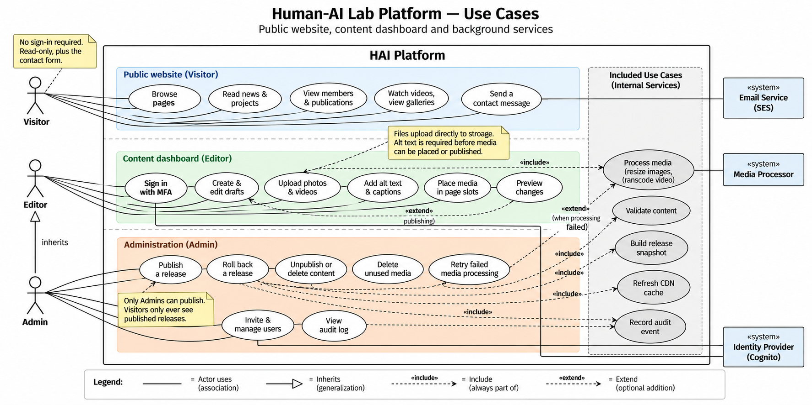

*Figure 1 — Use cases. Admins can do everything Editors can, plus publishing and administration.*

| Role | Who | Can do |
|---|---|---|
| **Visitor** | Anyone | Read the website; send a contact message. No sign-in. |
| **Editor** | Invited lab members | Create and edit drafts, upload photos and videos, add alt text, place media on pages, preview. |
| **Admin** | At least two senior members | Everything an Editor can, plus **publish**, **roll back**, delete content, manage users, view the audit log. |

Permissions are enforced by the server on every request, not just hidden in the dashboard.

---

## 3. Architecture

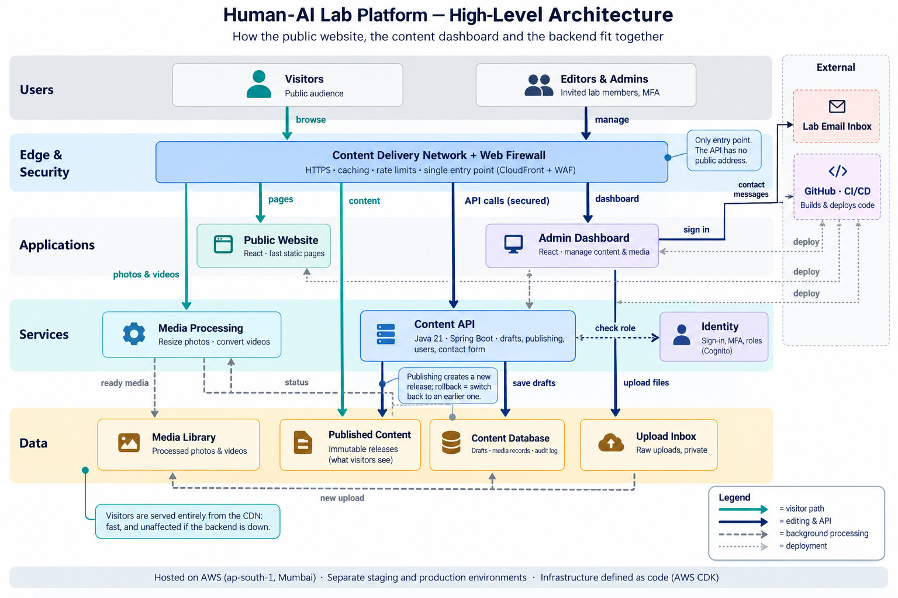

*Figure 2 — High-level architecture. Teal arrows are the visitor path; dark arrows are editing.*

The system has two sides joined by exactly one link, **publishing**:

| Part | What it is | Why |
|---|---|---|
| **Public Website** | Static React app served from the CDN | Fast everywhere, nearly free, no server to fail |
| **Admin Dashboard** | Separate React app at `admin.<domain>` | Isolated from the public site for security |
| **Content API** | Java / Spring Boot service | Drafts, media records, users, publishing, contact form |
| **Media Processing** | Serverless background jobs | Resizes photos, converts videos, strips GPS data |
| **Identity** | Amazon Cognito | Invite-only sign-in with MFA |
| **Data** | Database for drafts; file storage for releases and media | Drafts and published content are kept apart |

All traffic enters through one front door (CloudFront CDN + Web Application Firewall). The API has **no public address** of its own.

---

## 4. Information model

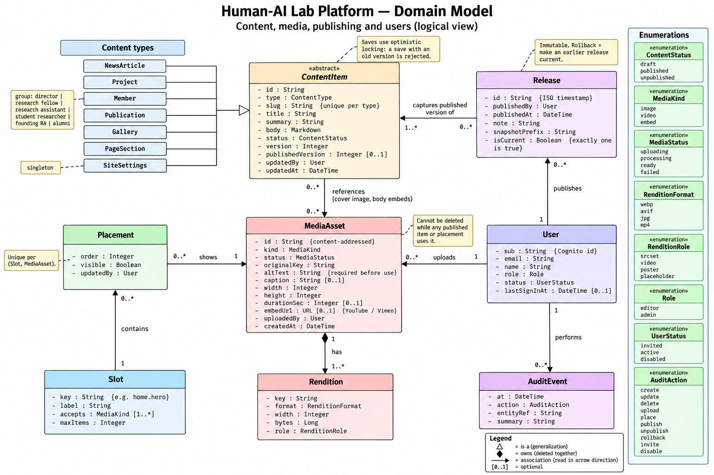

*Figure 3 — Domain model.*

- **Content items** — news, projects, members, publications, galleries, page sections and site settings. Each is a draft until published.
- **Media assets** — uploaded photos and videos, each with processed versions (*renditions*). Alt text is mandatory, and media in use cannot be deleted.
- **Slots and placements** — named spots on the site (e.g. *homepage gallery*) and the media placed in them, in order.
- **Releases** — frozen snapshots of the whole site. Exactly one is *current*.
- **Users and audit events** — who did what, and when.

---

## 5. How it works: key flows

Each flow below is a sequence diagram; the note at its foot states the guarantee it provides.

### 5.1 A visitor views a page

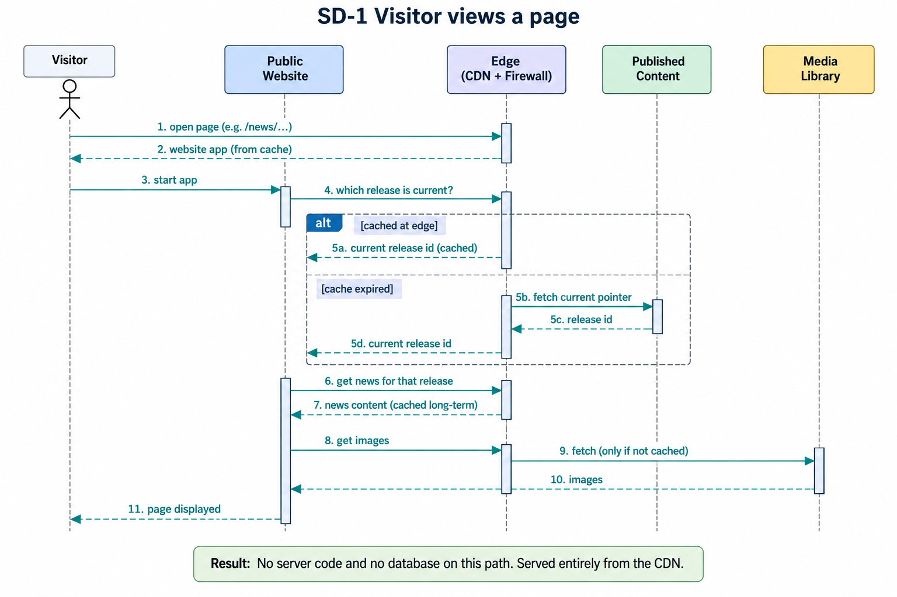

*Figure 4 — The whole visit is served by the CDN. No server code, no database.*

### 5.2 An editor signs in

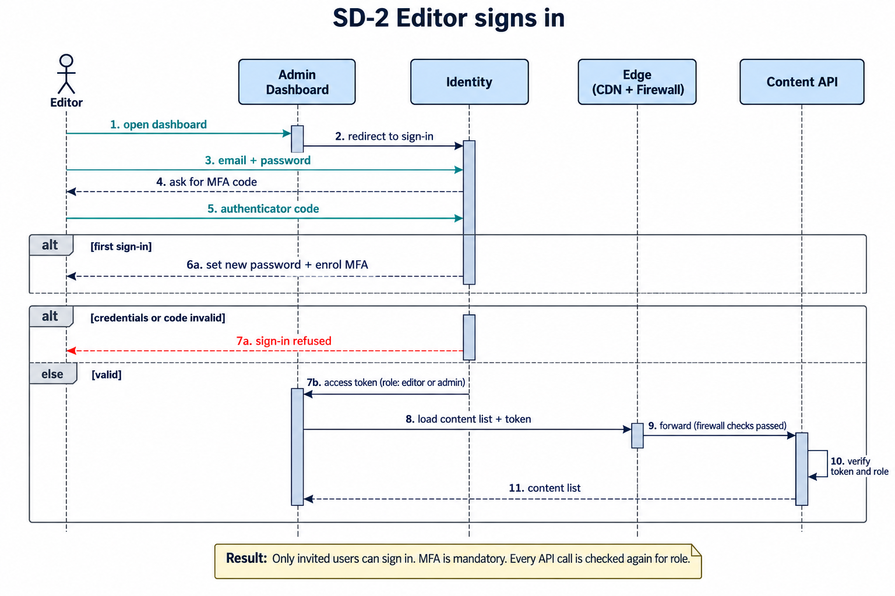

*Figure 5 — Invite-only, MFA required, and the role is checked again on every API call.*

### 5.3 An editor uploads media

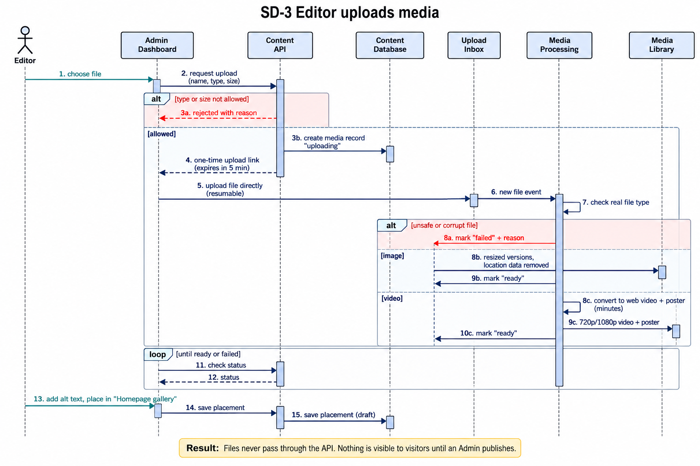

*Figure 6 — Files go straight to private storage and are checked and re-encoded before use. Nothing is public until published.*

### 5.4 An admin publishes a release

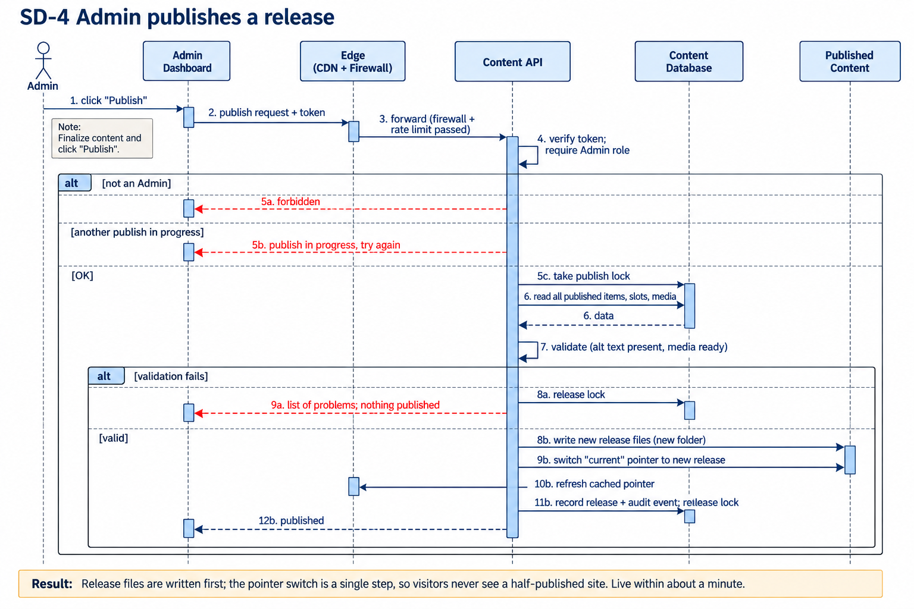

*Figure 7 — Content is validated, the new release is written in full, then switched on in one step. Visitors never see a half-published site.*

### 5.5 An admin rolls back

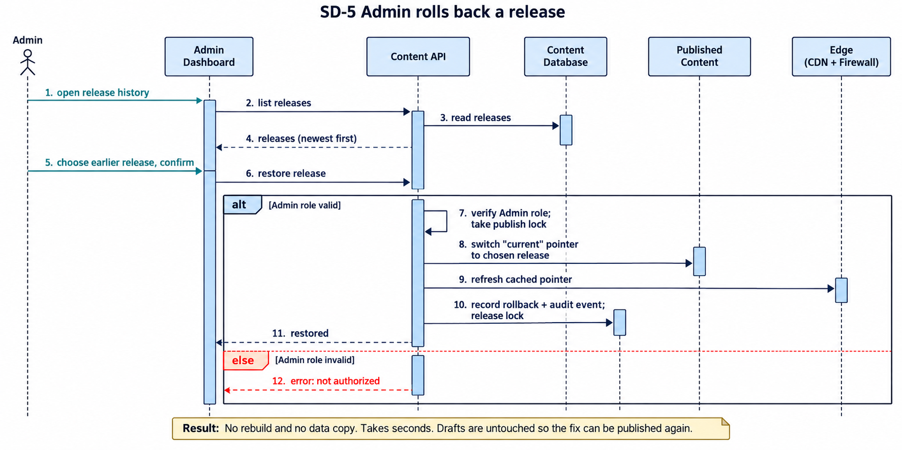

*Figure 8 — Rollback only moves the "current" pointer. It takes seconds and leaves drafts untouched.*

### 5.6 A visitor sends a contact message

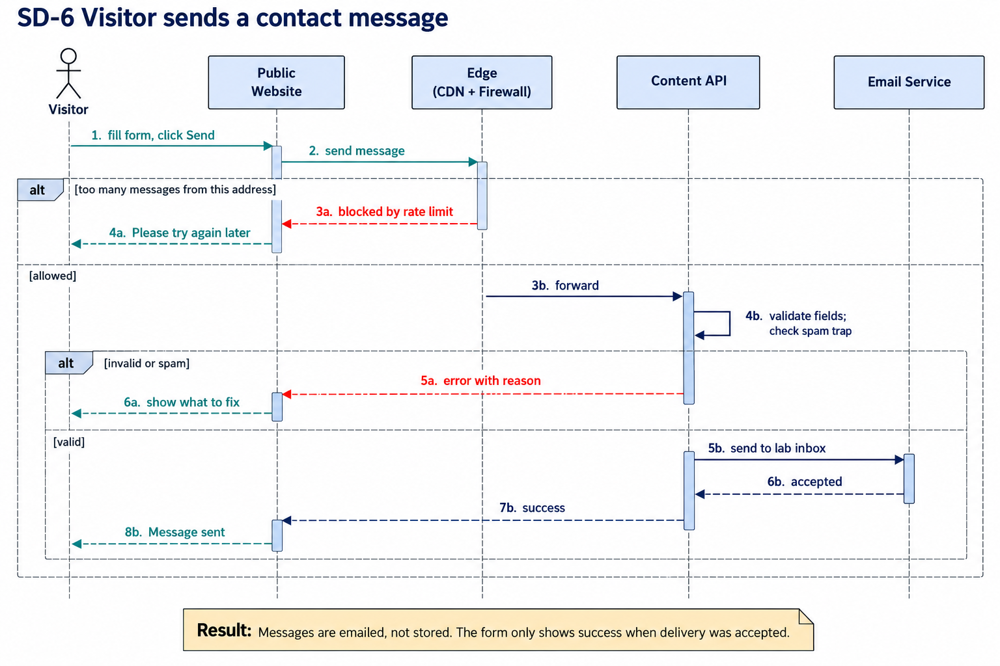

*Figure 9 — Rate-limited and spam-checked. Messages are emailed to the lab, not stored.*

---

## 6. Deployment on AWS

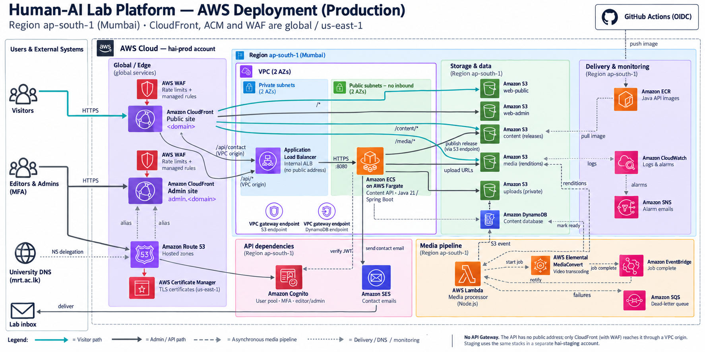

*Figure 10 — Production deployment. Staging is an identical copy in a separate AWS account.*

- **Region:** Mumbai (`ap-south-1`), the closest to Sri Lanka with every service needed.
- **Environments:** separate *staging* and *production* AWS accounts. Code merged to `dev` goes to staging; `main` goes to production after approval.
- **Everything is code:** infrastructure is defined with AWS CDK, so the whole environment can be rebuilt in under an hour.
- **Domains:** works on a lab-owned domain and/or a `mrt.ac.lk` subdomain.

**Estimated monthly cost**

| | Production | Staging |
|---|---|---|
| API (Lambda) + internal load balancer | ≈ $21 | ≈ $20 |
| Web firewall | ≈ $11 | ≈ $8 |
| CDN, storage, database, media, email, logs | ≈ $6–9 | ≈ $2–3 |
| **Total** | **≈ $38–41** | **≈ $30–32** |

Budget alerts at $90 and $110. The API runs on Lambda, so it costs almost nothing when idle.

---

## 7. Security

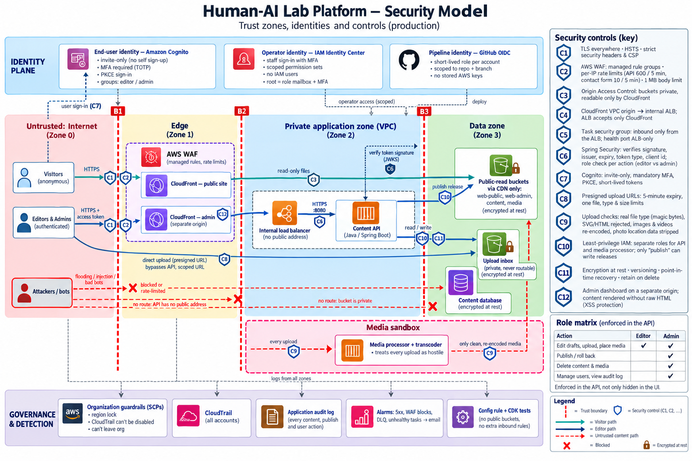

*Figure 11 — Trust zones and controls C1–C12.*

In short:

- **One way in.** Every request passes the CDN and Web Application Firewall (rate limits, attack filtering). The API and storage cannot be reached directly.
- **Strong identity.** Dashboard is invite-only with mandatory MFA. No passwords or long-lived keys are stored anywhere; deployments use short-lived GitHub credentials.
- **Uploads are treated as hostile.** File type is checked from its contents, then every image and video is re-encoded in an isolated sandbox.
- **Least privilege.** Only the publish step can write to the public releases.
- **Recoverable.** Encrypted storage, versioning, point-in-time database recovery, and a full audit log.

---

## 8. Key design decisions

| Decision | Chosen over | Reason |
|---|---|---|
| Publish frozen snapshots to the CDN | Site reads the database live | Public site stays up even if the backend fails; instant rollback |
| Build a small custom dashboard | Hosted CMS (Sanity, Contentful) | Data stays in the lab's account; no per-seat fees; same tech stack |
| Java / Spring Boot on AWS Lambda, behind a private load balancer | Containers (Fargate), or Lambda + API Gateway | Team skills, no servers to run, pay per use; the load balancer keeps the API private and can later route to server-rendered pages |
| DynamoDB | Relational database | No idle cost; data access patterns are few and known |
| Separate staging and production accounts | Single account | Mistakes in one cannot affect the other |

**The main trade-off:** the private load balancer and web firewall cost about $60/month of the total, versus about $5/month for a design without them. We accept this for keeping the API off the public internet and for room to grow.

---

## 9. Roadmap

The move from today's Netlify site to the AWS platform is planned over **26 weeks (about six months)**. The live site stays on Netlify until the new platform is proven on staging, so visitors see no disruption during the build.

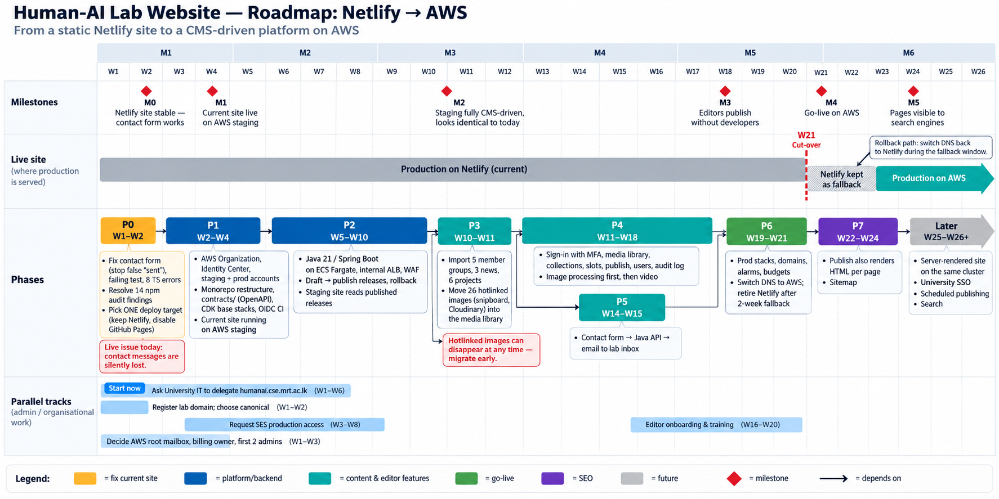

*Figure 12 — Project plan. Phases (coloured bars) run in dependency order; red diamonds are milestones; the bottom rows are admin work that runs in parallel.*

### 9.1 Milestones

| Milestone | Week | What it proves |
|---|---|---|
| **M0** Netlify site stable | W2 | The current site is cleaned up and its contact form works |
| **M1** Current site live on AWS staging | W4 | The AWS accounts, pipeline and hosting work end to end |
| **M2** Staging fully CMS-driven | W10 | The site renders entirely from published releases and looks identical to today |
| **M3** Editors publish without developers | W18 | Lab members can update the site on their own |
| **M4** Go-live on AWS | W21 | Production traffic is served from AWS |
| **M5** Pages visible to search engines | W24 | News and project pages show up properly in search results and link previews |

### 9.2 Phases

**P0 — Fix the current site (W1–W2).** Before building anything new, the existing Netlify site is stabilised: the contact form is wired up with proper error handling, the 14 npm security findings are resolved, and the unused contact modal is either removed or kept disabled until the new contact endpoint exists (P5). *Outcome: M0.*

**P1 — Foundations (W2–W4).** The AWS Organization is created with Identity Center and separate staging and production accounts. The code is restructured into a monorepo with a shared `contracts/` folder (OpenAPI), the base CDK stacks and the GitHub OIDC deployment pipeline are set up, and today's site is deployed to AWS staging unchanged. *Outcome: M1.*

**P2 — Content API and publishing (W5–W10).** The Java 21 / Spring Boot service is built and deployed on AWS Lambda (with SnapStart for fast start-up), behind the internal load balancer and web firewall. A short spike first confirms cold-start times and the load-balancer integration. It implements the core workflow (drafts → published releases → rollback), and the staging site is switched to read its content from published releases.

**P3 — Content migration (W10–W11).** All existing content is imported into the platform: 5 member groups, 3 news articles and 6 projects. The 26 images currently hotlinked from third-party hosts (snipboard.io, Cloudinary) are moved into the lab's own media library. This is scheduled early because hotlinked images can disappear at any time. *Outcome: M2.*

**P4 — Dashboard and media (W11–W18).** The editor-facing dashboard is built: sign-in with MFA, media library, content collections, slots, publishing, user management and the audit log. Image processing is delivered first, then video. *Outcome: M3.*

**P5 — Contact form (W14–W15).** Runs alongside P4. The website's contact form is connected to the Java API, which emails messages to the lab inbox.

**P6 — Go-live (W19–W21).** Production stacks, domains, alarms and budgets are set up. DNS is switched to AWS in W21. Netlify is kept running as a fallback for two weeks and retired afterwards. *Outcome: M4.*

**P7 — Search engine visibility (W22–W24).** Publishing also renders a static HTML version of every page, and a sitemap is generated, so search engines and social media previews can read the content. *Outcome: M5.*

**Later (W25 onward).** Features for when they are needed: a fully server-rendered site on the same infrastructure, sign-in with university accounts (SSO), scheduled publishing, and search.

### 9.3 Cut-over and fallback

The switch to AWS happens in **week 21**. For the next two weeks, the Netlify site is left running untouched. If a serious problem appears, DNS is simply pointed back to Netlify, and visitors return to the old site within minutes. Netlify is only retired once the AWS site has run cleanly through this window.

### 9.4 Parallel tracks (administrative work)

These tasks involve the university and the department rather than code. Several have long lead times, so they start in week 1.

| Task | Weeks | Why it matters |
|---|---|---|
| Ask University IT to delegate `humanai.cse.mrt.ac.lk` | W1–W6 · **start now** | Needed for the production domain; depends on another team's schedule |
| Register the lab domain and choose the primary (canonical) one | W1–W2 | Decides the site's permanent address |
| Decide the AWS root mailbox, billing owner and first two Admins | W1–W3 | Needed before the AWS accounts can be created in P1 |
| Request Amazon SES production access | W3–W8 | Needed so the contact form can email any address |
| Editor onboarding and training | W16–W20 | Editors must be confident before go-live |

---

*The full technical specification (API endpoints, data store design, build and test strategy) is in the [Technical Design Document](./technical-design.md).*
