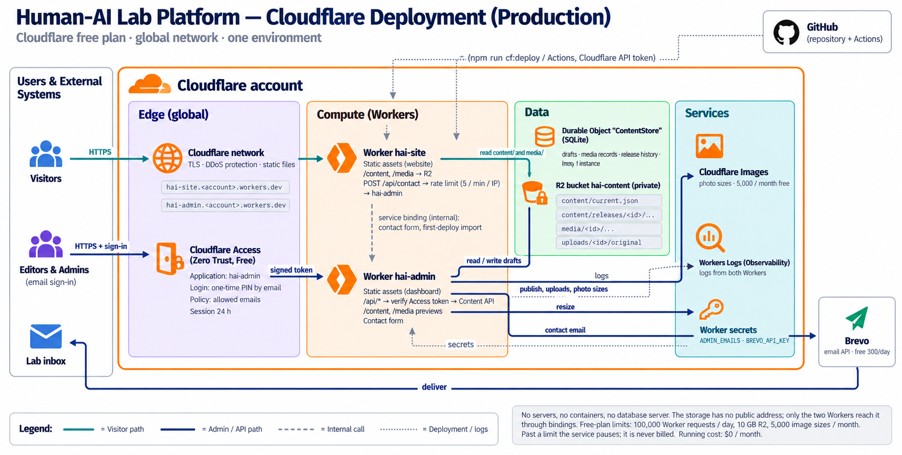

# Human-AI Lab Platform — System Design

*A new website and content dashboard for the Human-Centered AI Research Lab, Department of Computer Science and Engineering, University of Moratuwa.*

| | |
|---|---|
| **Author** | Daham Pathiraja |
| **Email** | daham.23@cse.mrt.ac.lk |
| **Document** | System Design Document |
| **Version** | 0.3 · Draft for review |
| **Date** | 27 September 2026 |
| **Frontend** | React 19 · TypeScript |
| **Backend** | TypeScript on Cloudflare Workers |
| **Cloud** | Cloudflare (global network) · free plan |
| **Running cost** | $0 / month |
| **3-year cost** | $0–33 (domain only) |
| **Status** | Live on Cloudflare; public site on Netlify until cut-over |

> **What changed since version 0.2.** Version 0.2 planned the platform on AWS (Java on Lambda, CloudFront, DynamoDB, Cognito) at about $65–75 a month. The platform has since been **built and deployed on Cloudflare's free plan**, with the Content API rewritten in TypeScript. The design idea is unchanged (drafts are published as frozen releases) and so is the API contract, but the running cost is now **$0**. The Java service stays in the repository for reference and is not deployed.

---

## Summary

Today the lab website runs on Netlify and is edited by changing code: every update needs a developer, a commit and a redeploy, and many images are hotlinked from third-party sites that can vanish at any time.

The new platform lets **invited lab members update the website themselves** through a secure dashboard, while the public site stays **fast, free and online** even when the dashboard is not.

> **The one idea to remember.** Editors work on *drafts*. Nothing reaches visitors until an Admin clicks **Publish**, which saves a complete, frozen snapshot of the site (a *release*). Visitors only ever read these snapshots, never the drafts. So a problem in the dashboard cannot take the public site down, and any mistake can be undone in seconds by switching back to an earlier release.

**Targets at a glance**

| Goal | Target |
|---|---|
| Page load (mid-range phone, 4G, Sri Lanka) | under 2.5 s |
| Public site availability | ≥ 99.9 %, unaffected if the dashboard is down |
| Time for a publish to go live | on the next page load (seconds) |
| Undo a bad publish | under 1 minute |
| Dashboard security | invited people only; sign-in with a code emailed to them |
| Running cost | $0 a month; expected usage is under a quarter of every free allowance (§7) |

---

## 1. Scope

**In scope:** the public website, the admin dashboard (content, photos, publishing, rollback), the Content API behind it, and the Cloudflare hosting, deployment and monitoring.

**Not in this version:** public user accounts or comments, search across publications, newsletters, and server-side rendering (planned, see §10). Video uploads, page slots, user management inside the dashboard and the audit log are designed but not built yet; they appear greyed out and marked *planned* in the figures.

---

## 2. Users and what they can do

*Figure 1 — Use cases. Admins can do everything Editors can, plus publishing and administration. Greyed-out use cases are planned.*

| Role | Who | Can do |
|---|---|---|
| **Visitor** | Anyone | Read the website; send a contact message. No sign-in. |
| **Editor** | Invited lab members | Create and edit drafts, upload photos, add alt text, preview. |
| **Admin** | At least two senior members | Everything an Editor can, plus **publish**, **roll back**, and delete content and photos. |

Who can sign in at all is set in **Cloudflare Access**: only the email addresses on its list receive a sign-in code. Who is an Admin is set by an admin list kept as a deployment secret. Permissions are enforced by the API on every request, not just hidden in the dashboard.

---

## 3. Architecture

*Figure 2 — High-level architecture. Teal arrows are the visitor path; dark arrows are editing.*

The system has two sides joined by exactly one link, **publishing**:

| Part | What it is | Why |
|---|---|---|
| **Public Website** | Static React app, served by the `hai-site` Worker | Pages are plain files on Cloudflare's network: fast everywhere, free, nothing to fail |
| **Admin Dashboard** | Separate React app, served by the `hai-admin` Worker at its own address | Isolated from the public site, behind its own sign-in gate |
| **Content API** | TypeScript, running in the `hai-admin` Worker | Drafts, photos, publishing, rollback, contact form, sign-in check |
| **Content Store** | A Cloudflare Durable Object with a SQLite database | Drafts, photo records and release history in one place, so saves and publishes are exact |
| **Published files and photos** | One private R2 storage bucket | Releases (what visitors see), processed photos and original uploads |
| **Photo processing** | Cloudflare Images | Makes web-sized copies of every photo and removes location data |
| **Identity** | Cloudflare Access | Invite-only sign-in with a code emailed to the person |
| **Email** | Brevo (email service) | Delivers contact-form messages to the lab inbox |

All traffic arrives through Cloudflare's network. The storage has **no public address**: only the two Workers can reach it.

---

## 4. Information model

*Figure 3 — Domain model. Greyed-out classes are planned.*

- **Content items**: news, projects, members, publications, research themes, galleries, page sections and site settings. Each is a draft until published.
- **Media assets**: uploaded photos, each with processed versions (*renditions*). Alt text is required before publishing, and photos in use cannot be deleted.
- **Releases**: frozen snapshots of the whole site. Exactly one is *current*.
- **Users**: people are identified by the email they sign in with; their role comes from the admin list.
- *Planned:* **slots and placements** (named spots on the site, such as the *homepage gallery*, and the media placed in them) and **audit events** (who did what, and when).

---

## 5. How it works: key flows

Each flow below is a sequence diagram; the note at its foot states the guarantee it provides.

### 5.1 A visitor views a page

*Figure 4 — Pages are static files; content comes from published files in storage, read by a small Worker. No database on this path.*

### 5.2 An editor signs in

*Figure 5 — Only invited people receive a sign-in code, and there are no passwords. The API checks the sign-in and the role again on every request.*

### 5.3 An editor uploads a photo

*Figure 6 — Every upload is checked and re-encoded before use, and location data is removed. Nothing is visible to visitors until an Admin publishes.*

### 5.4 An admin publishes a release

*Figure 7 — Content is validated, the new release is written in full, then switched on in one step. Visitors never see a half-published site.*

### 5.5 An admin rolls back

*Figure 8 — Rollback only moves the "current" pointer. It takes seconds and leaves drafts untouched.*

### 5.6 A visitor sends a contact message

*Figure 9 — Rate-limited and spam-checked. Messages are emailed to the lab, not stored.*

---

## 6. Deployment on Cloudflare

*Figure 10 — Production deployment on Cloudflare's free plan.*

- **Where it runs:** on Cloudflare's global network, so pages are served from a location near each visitor, including in Sri Lanka. There is no region to choose and no server to maintain.
- **What is deployed:** two Workers (`hai-site` for the public website, `hai-admin` for the dashboard and the Content API), one Durable Object for drafts, one R2 bucket for releases and photos, Cloudflare Images for photo sizes, and Cloudflare Access for sign-in.
- **One environment:** production. Changes are tried locally first with `npm run dev:local`, which runs the whole platform on a laptop without a Cloudflare account.
- **Deployment:** one command, `npm run cf:deploy`, or the **Deploy to Cloudflare** workflow in GitHub. The configuration is kept in the repository; the admin list and the email key are stored as secrets, never in the repository. A newcomer's guide is in [`cloudflare/README.md`](../../cloudflare/README.md).
- **Domains:** the site currently runs at `workers.dev` addresses. For the lab's own address, the domain must be managed by Cloudflare: either a lab-owned domain, or `humanai.cse.mrt.ac.lk` delegated to Cloudflare by University IT.

The running cost of this deployment is analysed in full in §7.

---

## 7. Cost analysis

### 7.1 The bottom line

| Item | Cost |
|---|---|
| **Running cost today** | **$0 a month** |
| **One-off costs** | $0 (a lab domain, if chosen, is about $10–11 a year) |
| **3-year total** | **$0** with the university subdomain, **≈ $33** with a lab `.com` domain |
| **Recommended contingency** | $60 a year (Workers Paid, $5/month), approved but only used if a trigger in §7.8 is reached |
| **Compared with the AWS plan (v0.2)** | ≈ $2,340–2,733 over 3 years; a saving of over 98 % |

Every service the platform uses has a permanent free allowance, and the lab's expected usage is well below each one. The largest share is R2 storage, at about a fifth of the allowance after the first year. The free plan does not expire and is not a trial.

### 7.2 What the platform uses, and what it would cost

Prices are Cloudflare's and Brevo's published rates, checked on 27 September 2026. "Lab estimate" uses the assumptions in §7.3.

| Service | Free allowance | Lab estimate | Share used | Price beyond the free allowance |
|---|---|---|---|---|
| **Worker requests** (both Workers) | 100,000 a day | ≈ 3,500 a day | 3.5 % | Workers Paid: $5/month incl. 10 M requests, then $0.30 per million |
| **Worker CPU time** | 10 ms per request | small; most time is waiting on storage, which is not counted | — | Workers Paid: 30 M CPU-ms included, then $0.02 per million |
| **Content Store** (Durable Object) | 100,000 requests a day; 5 GB | ≈ 500 requests a day; < 50 MB | < 1 % | Included in Workers Paid (1 M requests/month) |
| **R2 storage** | 10 GB | ≈ 2.1 GB after year 1 | 21 % | $0.015 per GB-month |
| **R2 reads** (Class B) | 10 M a month | ≈ 90,000 a month | 0.9 % | $0.36 per million |
| **R2 writes** (Class A) | 1 M a month | < 1,000 a month | 0.1 % | $4.50 per million |
| **Cloudflare Images** | 5,000 new image sizes a month | ≈ 75 a month (3 per photo) | 1.5 % | Images Paid: $0.50 per 1,000 |
| **Cloudflare Access** | 50 people | ≈ 10 editors and admins | 20 % | $7 per person per month, billed yearly |
| **Brevo email** | 300 emails a day | < 10 a day | 3.3 % | Starter: $9/month for 5,000 emails |
| **Workers Logs** | 200,000 events a day, kept 3 days | ≈ 7,000 a day | 3.5 % | Workers Paid: 20 M/month, kept 7 days |
| **Domain name** | `mrt.ac.lk` subdomain: free | — | — | `.com` at Cloudflare's at-cost price: ≈ $10.46/year, rising to ≈ $11.15 from 1 Nov 2026 |

Two things are free and unlimited on every plan, so they are not in the table: requests for the website's and dashboard's own files, and data transfer to visitors.

*Figure 11 — Expected use of each free allowance, now and in a growth scenario. Nothing comes close to its limit.*

### 7.3 Assumptions behind the estimates

These are deliberately generous for a university lab website. They should be replaced with real figures from Cloudflare's usage dashboard one month after go-live.

| Assumption | Value | Why it matters |
|---|---|---|
| Page views | 500 a day | Drives Worker requests and R2 reads |
| Worker requests per page view | ≈ 6 on average | 1 for the current release, 2 for content, about 7 for photos on a first visit; far fewer on repeat visits because the browser keeps content for a year and photos for a day |
| Dashboard use | ≈ 500 API calls a day | Several editors on a busy day |
| New photos | ≈ 300 a year, plus ≈ 150 at start | Drives R2 storage and image sizes |
| Storage per photo | ≈ 4.5 MB (original ≈ 4 MB, three web sizes ≈ 0.5 MB) | Originals are kept so a failed photo can be reprocessed |
| Release size | ≈ 0.3 MB, about 5 publishes a week | Every release is kept, which is what makes rollback instant |

Two design details keep costs down. **Requests for the website's own files are free and unlimited**, so only content and photos count. And **the Worker's daily cap also caps R2 reads**: even if the Worker served its full 100,000 requests every day, R2 reads would reach only about 3 million a month, under a third of R2's free 10 million.

### 7.4 Storage over time

R2 storage is the only allowance that grows steadily, because photos and releases accumulate.

| After | Photos | Estimated storage | Share of 10 GB | Monthly cost |
|---|---|---|---|---|
| Year 1 | ≈ 450 | ≈ 2.1 GB | 21 % | $0 |
| Year 3 | ≈ 1,050 | ≈ 5.0 GB | 50 % | $0 |
| Year 5 | ≈ 1,650 | ≈ 7.9 GB | 79 % | $0 |
| Year 7 | ≈ 2,250 | ≈ 10.8 GB | 108 % | ≈ $0.02 |

Even beyond the free 10 GB, the cost is tiny: 20 GB would cost about $0.15 a month. Two simple measures push the limit out by years if needed: shrinking stored originals to a sensible maximum size, and keeping only the most recent releases (for example the last 100).

### 7.5 What happens when a free limit is reached

On the free plan, most limits are **hard stops, not bills**: the service stops working until the allowance resets. The table shows what the lab would notice.

| Limit reached | What visitors or editors see | Recovers | Billed? |
|---|---|---|---|
| Worker requests (100,000/day) | Page layouts still load, but content and photos fail (error 1027) | At 00:00 UTC, which is **05:30 in Sri Lanka** | No |
| Worker CPU time (10 ms/request) | That one request fails | Immediately | No |
| Content Store | Dashboard saves and publishes fail; the public site is unaffected | Next day | No |
| Cloudflare Images (5,000/month) | New uploads are marked *failed*; existing photos keep working; Admins can retry later | Next month | No |
| Cloudflare Access (50 people) | The 51st person cannot sign in | When a seat is freed | No |
| Brevo (300/day) | The contact form says "try again later" | Next day | No |
| **R2 storage or operations** | Nothing: everything keeps working | — | **Yes, at the rates in §7.2** |

> **A correction to the diagrams.** Control C10 in the security model (Figure 13) and the note on the deployment diagram (Figure 10) say that past a limit a service "pauses" and is "never billed". That holds for everything **except R2**. Turning on R2 requires a payment card on the account, and R2 use beyond the free allowance is billed. Section 7.4 shows this exposure is a few cents a month at most, but the account's billing owner should know about it, and a billing notification should be set up (§7.8).

### 7.6 Scenarios

| Scenario | What changes | Free plan | With Workers Paid ($5/month) |
|---|---|---|---|
| **A. Normal lab use** | As in §7.3 | **$0**, 3.5 % of the daily request limit | $5 |
| **B. Five-fold growth** | 2,500 page views a day, 3× photos, 2× editors | **$0**, 16 % of the daily limit | $5 |
| **C. A viral day** | A paper or news item draws 30,000 page views in a day (≈ 180,000 requests) | **$0**, but content and photos stop loading from mid-day until 05:30 | **$5**; 180,000 requests is far inside the 10 M monthly allowance |
| **D. Bot flood** | Automated traffic against content or photos | **$0**, same effect as C | Few dollars at most; Cloudflare absorbs floods, and free firewall rules on the lab's domain block most of it before it reaches a Worker |
| **E. Storage passes 10 GB** | Around year 7 at the assumed rate | ≈ $0.02–0.15 a month | Same |
| **F. Video is added** | Planned feature | See below | See below |

**Video (scenario F)** is the one planned feature that could change the cost picture. Video files are large, and playing a video through a Worker makes many requests per viewing, which would use up the daily request allowance quickly. The recommended approach is to **embed long videos from YouTube or Vimeo**, which costs nothing and is already supported by the data model (`embedUrl`), and to store only short clips in R2. A paid video service can be costed separately if the lab ever needs self-hosted video.

### 7.7 Three-year cost compared with the alternatives

*Figure 12 — Three-year cost of ownership. Staff time is excluded because it is similar for all options.*

| Option | Monthly | 3 years | Notes |
|---|---|---|---|
| **Cloudflare free plan (as built)** | $0 | **$0–33** | $33 only if a `.com` domain is bought |
| Cloudflare with Workers Paid | $5 | $180–213 | Removes the daily cap; the insurance option |
| AWS design (version 0.2 plan) | $65–75 | $2,340–2,733 | Java API, CloudFront, DynamoDB, Cognito |

### 7.8 Keeping the cost at zero: controls and upgrade triggers

**Controls to put in place (all free, about 30 minutes in total):**

1. **Usage notifications** in the Cloudflare dashboard, set to alert at **50 %** of the daily Worker requests, so there is warning well before any limit.
2. **A billing notification** for any charge on the account, which covers the R2 exposure in §7.5.
3. **The right payment card.** R2 needs a card on file. It should belong to the lab or department (ideally a card with a low limit), not to a student who will graduate. This is part of the account-ownership task in §10.5.
4. **A monthly five-minute check** of the usage dashboard, added to the maintainer's routine.
5. **Tidy Access seats.** Remove people who leave the lab, since a seat stays taken until the person is removed.

**When to switch on Workers Paid ($5 a month):**

- daily Worker requests stay above **50 %** of the free limit for a week;
- the site hits the daily limit even once after go-live;
- requests start failing because of the 10 ms CPU limit (for example, a much larger site making publishing heavier);
- the lab expects a high-visibility event, such as a conference or a major announcement.

Switching takes a few minutes, needs no code change, and can be reversed.

### 7.9 Costs that are not on the bill

| Item | What it involves | Estimate |
|---|---|---|
| **Maintainer time** | Updating dependencies, managing the Access list, the monthly usage check, answering editors | A few hours a month; this, not hosting, is the real cost of the platform |
| **Account continuity** | The Cloudflare account must not depend on one person | Covered by the shared lab mailbox and a second admin (§10.5) |
| **Backups** | Published content is safe, because every release is kept in R2. Drafts live only in the Content Store | A regular export of drafts is planned (§10); cost $0 |
| **Leaving Cloudflare** | The API follows an open contract, and the data is plain files and SQLite | A code-porting job, not a data migration; no exit fee |

---

## 8. Security

*Figure 13 — Trust zones and controls C1–C10.*

In short:

- **One way in.** Every request arrives through Cloudflare's network, which absorbs attacks such as floods. The storage has no public address; only the two Workers can reach it.
- **Invite-only dashboard.** Cloudflare Access lets in only the email addresses on its list, with a code emailed each time. No passwords are stored anywhere. The API checks every sign-in token itself (signature, issuer, intended application, expiry) and checks the role for every action.
- **Uploads are treated as hostile.** File type is checked from the file's contents, size limits apply, and every photo is re-encoded with location and camera data removed.
- **The public site only reads published files.** Drafts and original uploads are never served to visitors.
- **Contact form is rate-limited and spam-checked.** At most 5 messages a minute from one address, and a hidden spam trap.
- **No secrets in the repository.** The repository is public; the admin list and the email key are stored as deployment secrets.
- **Recoverable.** Every release is kept, so the site can return to any earlier version in seconds.
- **Cost as a security concern.** Free-plan limits mean an attack cannot run up a large bill (C10), with the small R2 exception described in §7.5.

---

## 9. Key design decisions

| Decision | Chosen over | Reason |
|---|---|---|
| Publish frozen snapshots; visitors read only those | Site reads the drafts database live | Public site stays up even if the dashboard fails; instant rollback |
| Build a small custom dashboard | Hosted CMS (Sanity, Contentful) | Data stays in the lab's account; no per-seat fees; same technology as the website |
| **Cloudflare free plan** | AWS (planned in version 0.2, ≈ $65–75 a month) | $0 running cost; global network close to visitors; nothing to patch; one-command deployment a newcomer can run |
| **TypeScript Content API in a Worker** | Java / Spring Boot (built first) | Runs on the free plan without containers; one language across website, dashboard and API; same API contract and tests, ported |
| **Durable Object with SQLite** for drafts | DynamoDB, a relational database server | Free; one instance makes version checks and the publish lock exact |
| **Cloudflare Access** for sign-in | Amazon Cognito, self-built accounts | Free for up to 50 people; no passwords to store; invite-only by email |
| **Brevo** for contact email | Amazon SES, SMTP | Cloudflare's servers can't send over SMTP; Brevo works over HTTPS and is free at this volume |
| One production environment | Separate staging and production | The whole platform runs locally for testing; a second environment adds upkeep without much benefit at this size |

**The main trade-offs:**
- **Free-plan limits.** They are far above the lab's needs (§7), but a very large flood of requests could stop content loading until 05:30 the next morning. Free firewall rules on the lab's own domain reduce this risk, and Workers Paid removes it for $5 a month.
- **One provider.** The site depends on a single provider. The API follows an open contract (`contracts/openapi.yaml`) and the data is plain files and SQLite, so it could move again.
- **The Java codebase is no longer the deployed one.** It remains in the repository for reference.

---

## 10. Roadmap

The platform is built and running on Cloudflare. The public site stays on Netlify until the dashboard is in regular use and the lab's domain is ready, so visitors see no disruption. Weeks below count from **W1 = 28 September 2026** and are **proposed, to be confirmed**.

*Figure 14 — Project plan. Phases (coloured bars) run in dependency order; red diamonds are milestones; the bottom rows are admin work that runs in parallel.*

### 10.1 Milestones

| Milestone | When | What it proves |
|---|---|---|
| **M1** Platform live on Cloudflare | **Done** (27 Sep 2026) | Website, dashboard and API run on Cloudflare; the existing content was imported and published |
| **M2** Editors publish without developers | W4 (19 Oct) | Lab members update the site on their own |
| **M3** Go-live on the lab's domain | W8 (16 Nov) | Visitors are served from Cloudflare; Netlify is retired after a fallback period |
| **M4** Pages visible to search engines | W11 (7 Dec) | News and project pages show up properly in search results and link previews |

### 10.2 What is done

- The Content API, rewritten in TypeScript for Cloudflare: drafts, publishing, rollback and photo uploads, following the same contract and tests as the Java version.
- The existing site content (3 news articles, 5 publications, 4 research themes, 20 people) imported and published; the published files match the site's original data exactly.
- The dashboard, live behind Cloudflare Access, with editor and admin roles.
- One-command deployment, a GitHub workflow and a newcomer's guide.

### 10.3 Remaining phases

**P1 — Finish setup (W1).** Connect the contact form to Brevo, invite the editors in Cloudflare Access, and confirm that phone photos come out upright.

**P2 — Media migration (W1–W3).** Move the 26 images currently hotlinked from third-party hosts (snipboard.io, Cloudinary) into the lab's own media library. Scheduled early because hotlinked images can disappear at any time.

**P3 — Editor onboarding (W2–W4).** Short training for editors and admins, then editors publish on their own. *Outcome: M2.*

**P4 — Go-live (W5–W8).** Add the lab's domain to Cloudflare (or have `humanai.cse.mrt.ac.lk` delegated), attach it to the website, and switch on the free firewall rules and bot protection. Set up the cost controls in §7.8. DNS is switched to Cloudflare in W8. Netlify is kept running as a fallback for two weeks and retired afterwards. *Outcome: M3.*

**P5 — Dashboard features (W5–W12).** Projects in the dashboard, page slots and placements, a user list and the audit log, then video (embedded from YouTube or Vimeo by default, see §7.6).

**P6 — Search engine visibility (W9–W11).** Publishing also produces a static HTML version of every page, and a sitemap, so search engines and link previews can read the content. *Outcome: M4.*

**Later.** Features for when they are needed: server-rendered pages, sign-in with university accounts through Cloudflare Access, scheduled publishing, search, and regular exports of the drafts as a backup.

### 10.4 Cut-over and fallback

The switch happens in **W8**. For the next two weeks, the Netlify site is left running untouched. If a serious problem appears, DNS is pointed back to Netlify, and visitors return to the old site within minutes. Netlify is only retired once the new site has run cleanly through this window.

### 10.5 Parallel tracks (administrative work)

These tasks involve the university and the department rather than code. Some have long lead times, so they start now.

| Task | Weeks | Why it matters |
|---|---|---|
| Ask University IT to delegate `humanai.cse.mrt.ac.lk` to Cloudflare | W1–W6 · **start now** | Needed for the production address; depends on another team's schedule |
| Register the lab domain and choose the primary (canonical) one | W1–W2 | Decides the site's permanent address, and is the fallback if delegation is slow |
| Move the Cloudflare account to a shared lab mailbox, add a second account admin, and put a lab or department payment card on file | W1–W2 | The account and its billing must not depend on one person (§7.8) |
| Editor onboarding and training | W2–W4 | Editors must be confident before go-live |

---

**Pricing sources** (checked 27 September 2026): Cloudflare Workers, Durable Objects, R2 and Workers Logs pricing (developers.cloudflare.com/workers/platform/pricing); R2 pricing (developers.cloudflare.com/r2/pricing); Cloudflare Images pricing (developers.cloudflare.com/images/pricing); Cloudflare Zero Trust plans (cloudflare.com/plans); Brevo pricing (brevo.com/pricing); Cloudflare Registrar at-cost `.com` pricing and Verisign's registry price change of 1 November 2026. Prices change; re-check before any budget request.

*How to deploy and run the platform is described in [`cloudflare/README.md`](../../cloudflare/README.md). The [Technical Design Document](./technical-design.md) describes the earlier AWS design and has not yet been updated.*
