# Human-AI Lab Platform: Technical Design Document

**4+1 architectural view model**

| | |
|---|---|
| **Document** | Technical Design Document (detailed companion to the System Design) |
| **System** | Human-AI Lab website, content dashboard and AWS platform |
| **Version** | 0.5 (draft for review) |
| **Status** | Proposed |
| **Date** | 26 September 2026 |
| **Branch** | `aws-deployment` |
| **Related documents** | [system-design.md](./system-design.md) (short system design for reviewers and stakeholders) · [`CONTEXT.md`](../../CONTEXT.md) (domain glossary) · [`DESIGN.md`](../../DESIGN.md) (visual design system) |

---

## Contents

1. [Introduction](#1-introduction)
2. [Architectural drivers](#2-architectural-drivers)
3. [Architecture overview](#3-architecture-overview)
4. [Logical view](#4-logical-view)
5. [Process view](#5-process-view)
6. [Development view](#6-development-view)
7. [Physical view](#7-physical-view)
8. [Scenarios (+1)](#8-scenarios-1)
9. [Cross-cutting concerns](#9-cross-cutting-concerns)
10. [Architecture decisions](#10-architecture-decisions)
11. [Risks and technical debt](#11-risks-and-technical-debt)
12. [Roadmap and migration](#12-roadmap-and-migration)
13. [Open questions](#13-open-questions)
- [Appendix A: Data store design](#appendix-a-data-store-design)
- [Appendix B: Glossary](#appendix-b-glossary)
- [Appendix C: Maintaining this document](#appendix-c-maintaining-this-document)

---

## 1. Introduction

### 1.1 Purpose

This document describes the software architecture of the Human-AI Lab platform: the public website, the protected content dashboard, and the AWS infrastructure they run on. It is the reference for anyone who builds, reviews, operates or takes over the system.

It follows Philippe Kruchten's **4+1 view model**. Four views each answer a different stakeholder's questions, and a fifth set of scenarios ties them together:

| View | Question it answers | Primary audience |
|---|---|---|
| **Logical** (§4) | What does the system do, and what information does it manage? | Everyone, especially the lab and editors |
| **Process** (§5) | What runs, when, concurrently, and what happens when it fails? | Developers, operators |
| **Development** (§6) | How is the code organised, built and tested? | Developers, new contributors |
| **Physical** (§7) | Where does each part run on AWS, and how is it deployed? | Operators, department IT, budget holders |
| **Scenarios** (§8) | Do the four views work together for real tasks? | Everyone; used to validate the design |

### 1.2 Scope

**In scope**

- The public, informational website (`apps/web`, today's React site).
- A new **admin dashboard** for invited users to create and change content, upload photos and videos, and choose where media appears.
- The services, data stores and media pipeline behind the dashboard.
- AWS accounts, environments, domains, delivery pipeline and operations.

**Out of scope (this version)**

- Public user accounts, comments, event registration, or any visitor-generated content.
- Search across publications (see roadmap, §12).
- Server-side rendering (planned; §12).
- Email newsletters.

### 1.3 System context

The Human-AI Lab (Department of Computer Science and Engineering, University of Moratuwa) needs a website the lab can keep current without developers. Today, content is compiled into the site from Markdown and `src/data.json`. Images are hotlinked from third-party hosts (Cloudinary, snipboard.io). Every change requires a commit and redeploy, and the hotlinked images can disappear at any time.

External parties the system interacts with:

| Party | Interaction |
|---|---|
| Visitors (students, researchers, industry, media, public) | Read the public website |
| Lab editors and admins | Use the dashboard |
| Lab inbox | Receives contact-form messages (via Amazon SES) |
| GitHub | Source code, pull requests, CI/CD (GitHub Actions) |
| University IT | Owns `mrt.ac.lk` DNS; delegates or adds records |
| Domain registrar | Registration of a lab-owned domain |
| YouTube / Vimeo | Optional host for long videos, embedded by URL |

---

## 2. Architectural drivers

### 2.1 Stakeholders and concerns

| Stakeholder | Concerns |
|---|---|
| Lab Director | Accuracy and credibility of public content; the lab's image; continuity |
| Editors (research staff, students) | Easy, safe way to add news, photos and videos; seeing changes before they go live |
| Admins | Control over what is published; managing who has access; undoing mistakes |
| Visitors | Fast pages, working links and media, accessibility, mobile use |
| Developers (often rotating students) | Understandable code, quick onboarding, safe deployments, low toil |
| Department / budget holder | Predictable, low monthly cost; ownership of the account and data |
| University IT | Minimal DNS work; security of anything under `mrt.ac.lk` |

### 2.2 Functional requirements

| ID | Requirement |
|---|---|
| FR-1 | Visitors can browse all public pages: home, about, themes, projects, news, pioneers (members), publications, contact. |
| FR-2 | Visitors can send a message through the contact form, which is delivered to the lab inbox. |
| FR-3 | Only invited users can sign in to the dashboard. Sign-in requires MFA. |
| FR-4 | Editors can create, edit, reorder and hide items of every content type: news, projects, members, publications, galleries, page sections, site settings. |
| FR-5 | Editors can upload photos and videos, add alt text and captions, and see processing status. |
| FR-6 | Editors can place media into named **slots** (e.g. homepage hero, homepage gallery) with order and visibility. |
| FR-7 | Editors can preview drafts as they will appear on the site. |
| FR-8 | Admins can publish all ready changes as a **release**, and roll back to any earlier release. |
| FR-9 | Admins can invite, change the role of, and disable users. |
| FR-10 | Admins can delete media that no published content uses. |
| FR-11 | Every change is recorded in an audit log that admins can view. |
| FR-12 | Existing content and images are migrated into the new system. |

### 2.3 Quality attribute requirements

| Attribute | Requirement (measurable) | Main tactics |
|---|---|---|
| **Performance** | Public pages: Largest Contentful Paint < 2.5 s on a mid-range phone over 4G in Sri Lanka. Content JSON per page ≤ 200 KB gzipped. Admin API p95 < 300 ms warm, < 1.5 s on a cold start. | CDN edge caching, immutable assets, responsive image renditions, small per-collection JSON, Lambda SnapStart |
| **Availability** | Public site ≥ 99.9%. Dashboard ≥ 99.5%. A failure of the API, database or media pipeline must **not** affect the public site. | Static site + published snapshots on S3/CloudFront, with no runtime dependency on the backend |
| **Freshness** | A publish is visible to visitors within 2 minutes. | Short cache on `current.json` + targeted invalidation |
| **Security** | 100% of dashboard accounts use MFA. No long-lived AWS keys anywhere. Public site holds no secrets. The API is unreachable except through CloudFront + WAF. Admin actions are role-checked on the server. | Cognito, Spring Security (JWT), WAF, CloudFront VPC origin to an internal ALB, OIDC deploy roles, least-privilege IAM, private buckets |
| **Recoverability** | Content RPO ≤ 5 minutes (DynamoDB PITR). Published site RTO < 1 minute (rollback). Full environment rebuild < 1 hour from code. | PITR, S3 versioning, retained originals, immutable releases, everything in CDK |
| **Maintainability** | New contributor can run the site locally within 1 hour. Adding a content type touches the schema, one dashboard form and one site component. | Monorepo, shared schema package, layered services, docs |
| **Cost** | ≈ $65–75/month across staging and production at expected traffic, with budget alerts at $90 and $110. | Serverless compute, storage, data and media. The internal load balancer and WAF are the only fixed costs |
| **Scalability** | Handle 10× normal traffic (e.g. a news story shared widely) without changes. | CloudFront absorbs read load; backend sees editor traffic only |
| **Accessibility** | Public site meets WCAG 2.2 AA. Every image has alt text. | Alt text required by the schema; semantic components (`DESIGN.md` §7) |
| **Privacy** | Uploaded photos carry no GPS or camera metadata. Contact messages are not stored beyond email delivery. | EXIF stripping in the processor. The contact endpoint forwards and discards |

### 2.4 Constraints

- **Stack continuity:** React 19, TanStack Router, Tailwind v4, TypeScript, Vite (existing codebase and team skills).
- **Cloud:** AWS, in a **new** account owned by the department.
- **Domains:** must work on a lab-registered domain **and** a `*.mrt.ac.lk` subdomain, individually or together.
- **People:** maintainers rotate (students graduate). No dedicated ops staff.
- **Budget:** small, and it must be predictable.

### 2.5 Assumptions

- Traffic is modest: thousands, not millions, of monthly visitors.
- Fewer than 20 dashboard users.
- Most videos are short (under 10 minutes). Longer recordings go to YouTube.
- Content volume is small: hundreds of items, not millions.

---

## 3. Architecture overview

The platform is a **serverless, headless-CMS architecture on AWS**:

- The **public website** is a static SPA on S3 + CloudFront. It reads **published, immutable JSON releases** and **processed media** from the same CloudFront domain, and never calls a database.
- The **admin dashboard** is a separate SPA on `admin.<domain>`, with sign-in through Cognito.
- A **Content API** in **Java 21 / Spring Boot 4**, running on **AWS Lambda** (SnapStart) as the target of an **internal Application Load Balancer**. It manages drafts in DynamoDB and also serves the contact endpoint. It is reachable only through CloudFront (with AWS WAF) over a **VPC origin** to that ALB. There is no API Gateway. **Publishing** turns the drafts into a new immutable release on S3.
- A **media pipeline** (S3 events, a Node.js Lambda with sharp, MediaConvert) turns raw uploads into web-ready images and video.

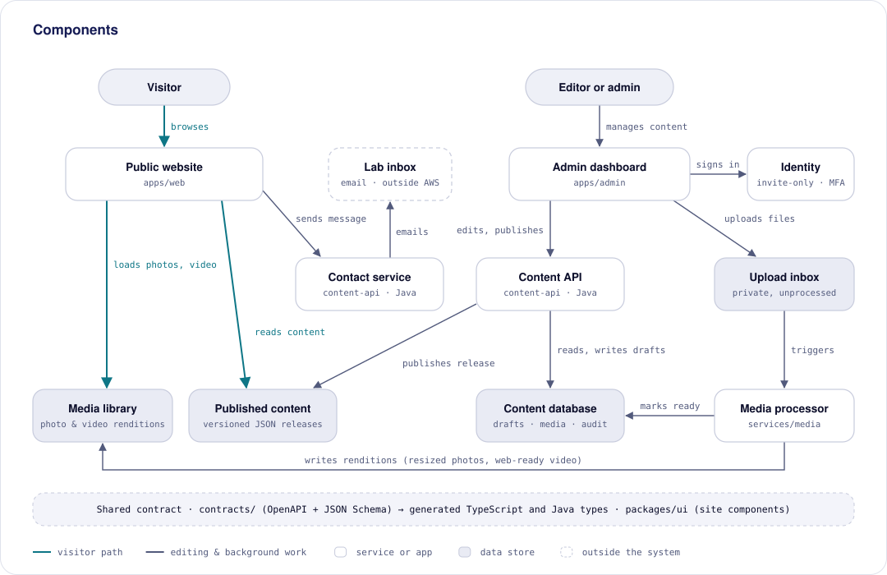

The central design rule: **the only link between the editing side and the public side is a publish.** Visitors are served entirely from the CDN, so the public site is as fast and as available as CloudFront and S3 themselves.

---

## 4. Logical view

The logical view describes **what the system does and what information it holds**, independent of technology.

### 4.1 Functional decomposition

| Component | Responsibility | Provides | Uses |
|---|---|---|---|
| Public website | Render public pages from the current release | Web pages | Published content, Media library, Contact service |
| Admin dashboard | Let editors and admins manage content, media, slots, releases and users | Dashboard UI | Identity, Content API, Upload inbox |
| Identity | Authenticate users, enforce MFA, issue tokens carrying the role | Sign-in, tokens | — |
| Content API | Manage drafts, media records, slots and users; issue upload URLs; publish and roll back | Admin REST API | Content database, Published content, Upload inbox, CDN |
| Media processor | Validate uploads and create renditions | Ready media | Upload inbox, Media library, Content database |
| Contact endpoint | Validate and deliver contact messages (part of the Content API service) | `POST /api/contact` | Email |
| Content database | Hold drafts, media records, placements, releases, audit | — | — |
| Published content | Hold immutable releases and the `current.json` pointer | Read-only JSON | — |
| Media library | Hold processed renditions | Read-only media | — |
| Upload inbox | Hold raw uploads until processed | Private storage | — |

### 4.2 Domain model

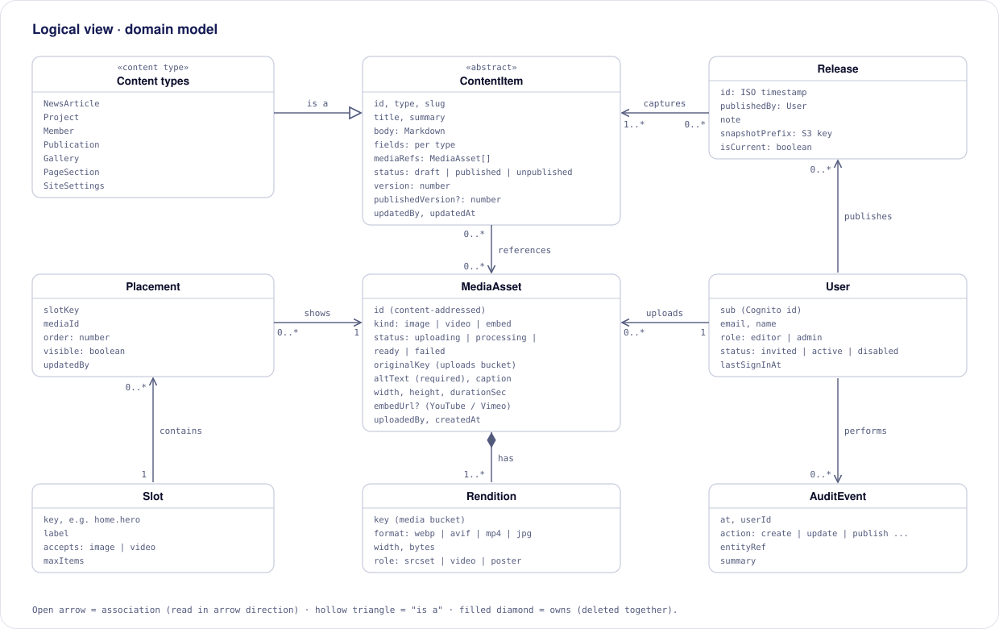

| Entity | Meaning | Key rules |
|---|---|---|
| **ContentItem** | Any editable piece of content. Specialised by content type. | `slug` unique per type. `version` increments on every save. Saves with a stale version are rejected (§5.4). |
| **Content types** | NewsArticle, Project, Member, Publication, ResearchTheme, Gallery, PageSection, SiteSettings. Each defines its own fields in the shared contract (`contracts/`). | Member has a `group` (director, research fellow, research assistant, student researcher, founding RA, alumni) matching today's `data.json`. SiteSettings is a singleton. |
| **MediaAsset** | An uploaded image or video, or an external embed. | `altText` is required before it can be placed or published. Can't be deleted while a published item or placement uses it. |
| **Rendition** | One processed output of a MediaAsset (e.g. 960 px WebP, 1080p MP4, poster JPEG). | Owned by its asset. Never overwritten; new processing produces new keys. |
| **Slot** | A named place on the site that shows media. Defined by developers in the schema. | Has `accepts` (image/video) and `maxItems`. |
| **Placement** | "This media, in this slot, at this position, visible or not." | Unique per (slot, media). |
| **Release** | An immutable snapshot of all published content at one moment. | Exactly one release is current. Releases are never modified. |
| **User** | A dashboard user. Identity lives in Cognito. | Role is `editor` or `admin`. Disabled users can't sign in. |
| **AuditEvent** | A record of one change. | Append-only. |

### 4.3 Initial slot catalogue

| Slot key | Page | Accepts | Max items |
|---|---|---|---|
| `home.hero` | Home, top banner | image, video | 1 |
| `home.gallery` | Home, gallery strip | image, video | 12 |
| `about.lab-space` | About, lab space photos | image | 8 |
| `themes.<theme>.cover` | Research themes | image | 1 each |
| `pioneers.group-photo` | Members page header | image | 1 |

New slots are added in code (schema + site component). The dashboard picks them up automatically.

### 4.4 Roles and permissions

| Capability | Editor | Admin |
|---|:---:|:---:|
| Sign in (with MFA) | ✓ | ✓ |
| Create and edit drafts, reorder, hide | ✓ | ✓ |
| Upload media, edit alt text and captions | ✓ | ✓ |
| Place media in slots | ✓ | ✓ |
| Preview | ✓ | ✓ |
| Publish, unpublish, roll back | | ✓ |
| Delete content items and media | | ✓ |
| Retry failed media processing | | ✓ |
| Invite, change role, disable users | | ✓ |
| View audit log | | ✓ |

Permissions are enforced by the Content API from the `cognito:groups` claim. The dashboard hides controls for convenience only.

### 4.5 Interfaces

#### Admin API (`admin.<domain>/api`, Cognito access token required)

| Method | Path | Role | Purpose |
|---|---|---|---|
| `GET` | `/content/{type}` | editor | List items of a type (drafts, with status) |
| `POST` | `/content/{type}` | editor | Create an item |
| `GET` | `/content/{type}/{id}` | editor | Get one item |
| `PUT` | `/content/{type}/{id}` | editor | Save an item. Requires `If-Match: <version>`, and returns `409` on conflict |
| `POST` | `/content/{type}/{id}/unpublish` | admin | Hide from the next release |
| `DELETE` | `/content/{type}/{id}` | admin | Delete (drafts and unpublished only) |
| `GET` | `/media?cursor=` | editor | List media, newest first |
| `POST` | `/media/uploads` | editor | Start an upload. Returns `mediaId` and presigned part URLs |
| `POST` | `/media/{id}/complete` | editor | Complete a multipart upload |
| `POST` | `/media/embeds` | editor | Register a YouTube/Vimeo URL |
| `PATCH` | `/media/{id}` | editor | Update alt text and caption |
| `GET` | `/media/{id}/usage` | editor | Where the asset is used |
| `POST` | `/media/{id}/retry` | admin | Re-run processing of a failed asset |
| `DELETE` | `/media/{id}` | admin | Delete if unused |
| `GET` | `/slots` | editor | Slots and their placements |
| `PUT` | `/slots/{key}` | editor | Replace a slot's placements (ordered list) |
| `POST` | `/publish` | admin | Publish a new release `{ note }` |
| `GET` | `/releases` | admin | List releases, newest first |
| `POST` | `/releases/{id}/restore` | admin | Roll back to a release |
| `GET` / `POST` / `PATCH` | `/users`, `/users/{sub}` | admin | List, invite, change role, disable |
| `GET` | `/audit?month=YYYY-MM` | admin | Audit events |

Errors use one JSON shape (RFC 9457 problem details): `{ "type": "…/version-conflict", "title": "…", "status": 409, "code": "VERSION_CONFLICT", "details": {…} }`. The API is defined **contract-first** in `contracts/openapi.yaml`. Java interfaces and DTOs are generated from it and validated with Bean Validation, and the dashboard uses a generated TypeScript client with Zod validators.

#### Public API

| Method | Path | Purpose |
|---|---|---|
| `POST` | `/api/contact` | `{ name, email, subject?, message, website? }`. `website` is a honeypot field. Returns `{ success: true }` or a validation error. |

#### Published content format

```
/content/current.json                          ← the only mutable file (cached 30 s)
/content/releases/<releaseId>/site.json        ← settings, navigation, slots + placements
/content/releases/<releaseId>/news.json
/content/releases/<releaseId>/projects.json
/content/releases/<releaseId>/members.json
/content/releases/<releaseId>/publications.json
/content/releases/<releaseId>/themes.json
/content/releases/<releaseId>/galleries.json
/sitemap.xml                                   ← regenerated on publish
```

```jsonc
// /content/current.json
{ "schema": 1, "release": "2026-10-02T09-15-00Z", "publishedAt": "2026-10-02T09:15:00Z" }

// /content/releases/2026-10-02T09-15-00Z/news.json
{
  "schema": 1,
  "items": [
    {
      "id": "n_7f3a",
      "slug": "spinq-gemini-2-pro-quantum-computer",
      "title": "HumanAI Research Lab Welcomes SpinQ Gemini 2 Pro Quantum Computer",
      "date": "2026-07-28",
      "summary": "…",
      "body": "Markdown…",
      "cover": {
        "alt": "SpinQ Gemini 2 Pro on a lab bench",
        "src": "/media/m_91c2/960.webp",
        "srcset": "/media/m_91c2/480.webp 480w, /media/m_91c2/960.webp 960w, /media/m_91c2/1600.webp 1600w",
        "width": 1600, "height": 1067,
        "placeholder": "data:image/webp;base64,…"
      }
    }
  ]
}
```

Media is referenced by root-relative paths, so releases work unchanged on every hostname. The `schema` field lets the site handle format changes.

### 4.6 Dashboard scope (v1)

- Sign-in, MFA setup, sign-out.
- **Media library:** drag-and-drop upload with progress, processing status, alt text (required) and caption, search and filter, and where each asset is used.
- **Collections:** list, create, edit, reorder and hide news, projects, people (all groups, including alumni and founding RAs), publications, research themes and galleries. Markdown editor with a media picker.
- **Slots:** pick, order and show or hide media for each site slot.
- **Publish, release history, roll back** (admin only).
- **Users:** invite, change role, disable (admin only).
- **Audit log** view (admin only).

---

## 5. Process view

The process view describes **what runs, what triggers it, how concurrent work is kept consistent, and how failures are handled**.

### 5.1 Runtime units

| Unit | Trigger | Concurrency | Timeout / size | Failure handling |
|---|---|---|---|---|
| Browser: public SPA | Visitor | One per visitor | — | Shows cached content. A friendly error if `current.json` can't load |
| Browser: dashboard SPA | Editor | One per editor | — | Surfaces API errors with a clear action (§5.5) |
| CloudFront Functions (SPA rewrite, canonical-host redirect) | Every viewer request | Edge, unlimited | < 1 ms | Stateless |
| Content API (Spring Boot on Lambda) | HTTPS from CloudFront → VPC origin → internal ALB → Lambda target group | One request per Lambda instance. Reserved concurrency 20 (caps cost and protects DynamoDB) | 30 s timeout, 2048 MB. Request and response body ≤ 1 MB (ALB limit) | Typed error responses. Failed deploys roll back by moving the `live` alias to the previous version |
| Contact endpoint (same service) | `POST /api/contact` via the public distribution | Shares the service. WAF limits each IP to 10 requests per 5 minutes | 10 s | Error returned to the form. Nothing stored |
| Media processor Lambda (Node.js) | S3 `ObjectCreated` (asynchronous) | Reserved 10 | 5 min, 2048 MB (sharp) | 2 automatic retries, then an SQS dead-letter queue, the asset marked `failed`, and an alarm |
| Media completion handler | EventBridge rule on MediaConvert job state | Shared with processor | 30 s | Same as above |
| MediaConvert job | Started by the processor | On-demand queue | Minutes | `ERROR` state → EventBridge → asset `failed` |
| Cleanup job | EventBridge Scheduler, daily | 1 | 5 min | Deletes uploads abandoned for more than 24 h. S3 lifecycle aborts incomplete multipart uploads after 1 day |

### 5.2 Lifecycles

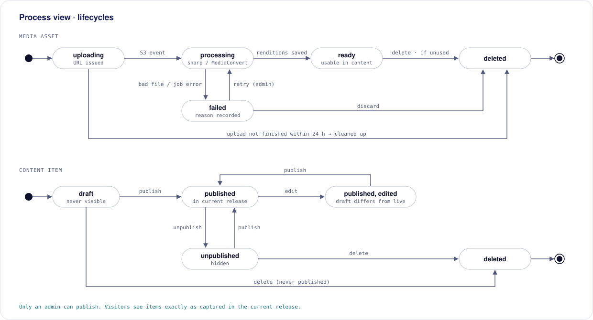

- **Media asset:** `uploading → processing → ready`. It becomes `failed` on a bad file or job error, where an admin can retry or discard. Uploads not finished within 24 hours are cleaned up automatically. A `ready` asset can be deleted only if nothing uses it.
- **Content item:** `draft → published`. Editing a published item creates *published, edited*: the live version is unchanged until the next publish. Admins can unpublish (hidden in the next release) and delete items that are not live.

### 5.3 Key interactions

The three most important runtime interactions are shown in §8 as sequence diagrams:
- a visitor reading a page (§8.3, SC-1)
- an editor uploading a video (SC-2)
- an admin publishing (SC-3)

### 5.4 Concurrency and consistency

| Concern | Design |
|---|---|
| Two editors save the same item | **Optimistic concurrency.** Each item has a `version`. `PUT` sends `If-Match`, and DynamoDB writes with `ConditionExpression: version = :expected`. The loser gets `409 VERSION_CONFLICT`, and the dashboard shows who changed it and offers a reload. |
| Many API instances run at once | Lambda instances are stateless. All state lives in DynamoDB and S3, so any instance can serve any request. Each instance caches Cognito's signing keys (JWKS) and refreshes them on an unknown key id. |
| Two admins publish at once | **Single-flight publish.** Publish takes a lock item (`LOCK/PUBLISH`, conditional put, 5-minute TTL). A second publish gets `409 PUBLISH_IN_PROGRESS`. |
| Visitors see a half-written release | Impossible by construction. All release files are written under a **new** prefix first, and `current.json` is swapped last, in a single S3 `PutObject`. |
| Visitors see a mix of two releases | The site reads `current.json` once per session load and fetches every collection from that one release id. |
| S3 events delivered twice | The processor is **idempotent**: it checks the asset's status with a conditional update (`uploading → processing`) and exits if another invocation already moved it. |
| Slug collisions | A guard item `SLUG#<type>#<slug>` is written in the same DynamoDB transaction as the content item. |
| Deleting media in use | A usage index (`MEDIA#<id> / USEDBY#…`) is maintained transactionally on save. Delete is refused if any usage exists. |

### 5.5 Error handling principles

- Validate at the edge of each service against the shared contract (Bean Validation in Java, Zod in TypeScript). Reject early with a specific error code.
- User-facing errors say what happened and what to do next (e.g. *"This video is 3.1 GB. The limit is 2 GB. Trim it or upload it to YouTube and paste the link."*).
- Background failures never disappear silently. They set a visible status (`failed` + reason), land in a dead-letter queue, and raise an alarm.
- No partial publishes: a failed publish leaves `current.json` untouched and releases the lock.

### 5.6 Media processing rules

| Kind | Accepted | Limit | Output |
|---|---|---|---|
| Images | JPEG, PNG, WebP, HEIC. **No SVG** (it can carry scripts) | 25 MB | Auto-rotated, EXIF/GPS stripped. WebP + AVIF at 480 / 960 / 1600 / 2400 px, plus a blur placeholder, served with `srcset` |
| Videos | MP4, MOV, WebM (including phone HEVC) | 2 GB, 20 min | H.264 MP4 at 720p and 1080p (byte-range seeking via CloudFront), poster frame, thumbnails |
| Embeds | YouTube or Vimeo URL | — | Stored as a `MediaAsset` of kind `embed`. Recommended for long lectures, to avoid CDN egress cost |

The real file type is checked from its contents (magic bytes), not the extension. Videos upload in resumable parts (S3 multipart). Originals are kept in the upload inbox (Infrequent Access after 30 days) so they can be re-processed later, for example to add HLS adaptive streaming.

---

## 6. Development view

The development view describes **how the source code is organised, built, tested and delivered**.

### 6.1 Repository structure

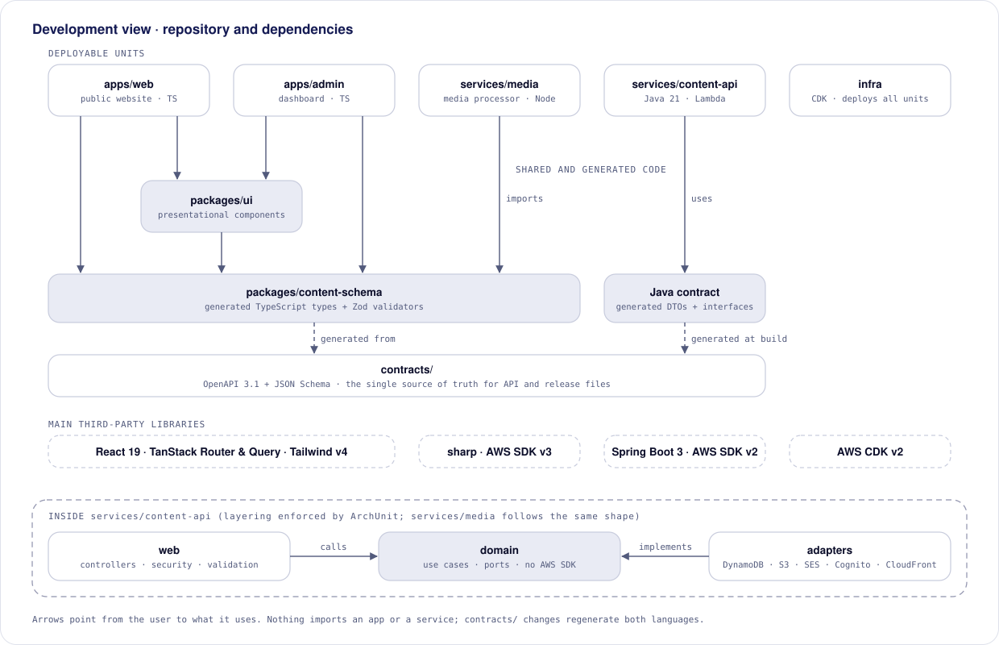

```
human-ai-lab/                       monorepo: npm workspaces (TypeScript) + Gradle (Java)
├── contracts/                      source of truth: openapi.yaml + JSON Schema for release files
├── apps/
│   ├── web/                        public website (today's src/ moves here)
│   └── admin/                      dashboard SPA
├── services/
│   ├── content-api/                Java 21 · Spring Boot 4 · Gradle (Kotlin DSL)
│   │   ├── build.gradle.kts        OpenAPI generator, Lambda zip (buildZip), ArchUnit, Testcontainers
│   │   └── src/main/java/lk/ac/mrt/cse/hai/api/
│   │       ├── LambdaHandler.java  ALB event → Spring (aws-serverless-java-container)
│   │       ├── web/                controllers (implement generated interfaces), problem details
│   │       ├── security/           resource-server config, role mapping, rate limits
│   │       ├── domain/             content, media, slots, releases, users · use cases · ports
│   │       ├── adapters/           dynamodb/ s3/ ses/ cognito/ cloudfront/
│   │       └── config/
│   └── media/                      media processor Lambda (Node.js, sharp)
│       └── src/{handlers,domain,adapters}/
├── packages/
│   ├── content-schema/             generated from contracts/: TypeScript types (Zod validators added in phase 4)
│   └── ui/                         presentational components shared by web + admin preview
├── infra/                          AWS CDK app (TypeScript)
│   ├── bin/  lib/stacks/  config/{staging,prod}.ts
├── scripts/
│   └── migrate-content.ts          one-off import of data.json, Markdown and hotlinked images
├── docs/                           this document, diagrams, agent docs
└── .github/workflows/              ci.yml, deploy.yml
```

### 6.2 Dependency rules

| Rule | Reason |
|---|---|
| Apps and services may import `packages/*`. Nothing imports `apps/*` or `services/*`. | Keeps deployable units independent |
| `contracts/` is the only place the API and release formats are defined. Generated code (`packages/content-schema`, Java DTOs and interfaces) is never edited by hand. CI fails if generated code is stale. | One contract, two languages, no drift |
| `packages/ui` is presentational: props in, markup out, no data fetching. | The same components render live pages and dashboard previews |
| Inside a service: `web → domain`. `adapters` implement ports defined in `domain`. `domain` has **no** AWS SDK or Spring Web imports. | Business rules (publishing, permissions, lifecycle) are unit-testable without AWS |
| Only `infra/` knows resource names. Services receive them as environment variables. | Staging and production run identical code and images |

Enforced with ESLint `import/no-restricted-paths` and TypeScript project references for TypeScript, and **ArchUnit** tests for the Java packages.

### 6.3 Conventions

- TypeScript strict mode. `verbatimModuleSyntax` is kept (existing `tsconfig`).
- Java 21 with records for DTOs, constructor injection, no field injection, Spotless (google-java-format). Spring configuration via `application.yml` and environment variables only. No secrets in config.
- UI follows [`DESIGN.md`](../../DESIGN.md). The existing rule in [`AGENTS.md`](../../AGENTS.md) (every `.map()` delegates to a named item component) applies to both apps.
- Domain terms follow [`CONTEXT.md`](../../CONTEXT.md) (e.g. *Lab Member*, *Research Publication*).
- Files that are generated (`routeTree.gen.ts`, diagrams) are never edited by hand.

### 6.4 Build and test strategy

| Level | Scope | Tools | Runs |
|---|---|---|---|
| Static | Types, lint, formatting, dependency rules, generated code up to date | `tsc -b`, ESLint, Spotless, ArchUnit, contract regeneration diff | Every PR |
| Unit | Domain use cases (publish, permissions, lifecycles) with in-memory adapters | JUnit 5 (Java), Vitest (TypeScript) | Every PR |
| API slice | Controllers, security rules (editor vs admin), error mapping, with mocked JWTs | Spring Boot Test (`@WebMvcTest`, `spring-security-test`) | Every PR |
| Adapter | DynamoDB, S3 and SES adapters against real local services | Testcontainers (DynamoDB Local, LocalStack) | Every PR |
| Contract | Responses match `contracts/openapi.yaml` | OpenAPI response validation in API tests | Every PR |
| Component | Site and dashboard components, forms | Vitest + Testing Library | Every PR |
| Infrastructure | Stack assertions (private buckets, internal ALB, no public ingress, WAF attached, retain policies, alarms) | CDK `assertions` | Every PR |
| Smoke / E2E | Visitor pages load. Sign in → upload image → publish → visible, on staging | Playwright | After each staging deploy |

### 6.5 Local development

- `npm run dev:local` runs the Content API (`local` profile), the dashboard and the website together. The API's local storage adapters keep drafts and releases as files in `.local-data/`, laid out as in the S3 content bucket, and it imports the site's existing news on first start. Sign-in is simulated through an `X-Local-Role` header that only the `local` profile accepts.
- `npm run dev -w @hai/web` serves the site with its bundled Markdown content; `dev:releases` reads published releases instead (`VITE_CONTENT_SOURCE=releases`).
- `npm run dev -w apps/admin` runs the dashboard against the **staging** API and user pool, or against a local API.
- `./gradlew bootRun --args='--spring.profiles.active=local'` runs the Content API with Docker Compose services: DynamoDB Local, LocalStack (S3, SES) and a mock OAuth2 server that issues test tokens for the `editor` and `admin` roles.
- No AWS access is needed to work on the public site or the API locally.

### 6.6 Delivery pipeline and branching

- **Branches:** feature branches → PR into `dev` (deploys to staging) → PR from `dev` into `main` (deploys to production after approval in a GitHub Environment).
- **CI (every PR):** install → static checks → unit/component/adapter/infra tests → `cdk diff` posted as a PR comment.
- **CD (on merge):** GitHub Actions assumes a deploy role in the target account via **OIDC** → Gradle builds the API Lambda zip → `cdk deploy` publishes a new Lambda version (SnapStart snapshot) and moves the `live` alias → build the web apps → `s3 sync` (hashed assets first, `index.html` last) → CloudFront invalidation → smoke tests (staging).
- Code deploys and content publishing are independent. A deploy never touches the database or published releases.

---

## 7. Physical view

The physical view describes **where each component runs, how the environments are laid out, and how requests reach them**.

### 7.1 Deployment

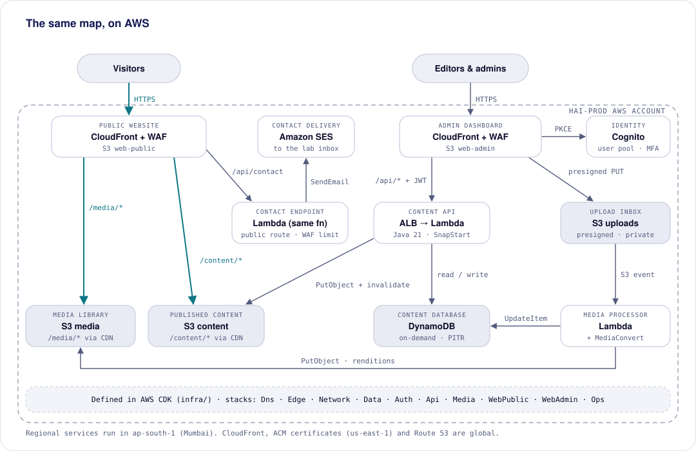

| Component | AWS resources | CDK stack |
|---|---|---|
| Public website | CloudFront distribution (public), S3 `web-public`, CloudFront Functions, response headers policy | `WebPublic` |
| Admin dashboard | CloudFront distribution (admin), S3 `web-admin`, response headers policy | `WebAdmin` |
| Identity | Cognito user pool (self-sign-up off, TOTP MFA required), app client (PKCE), groups | `Auth` |
| Content API | Lambda (Java 21, SnapStart, 2048 MB, alias `live`), internal ALB (HTTPS) with a Lambda target group, CloudFront VPC origin, execution role | `Api` |
| Contact endpoint | Same Lambda function. SES identity and configuration set | `Api` |
| Media processor | Lambda (Node.js, arm64, sharp layer), MediaConvert role + job template, EventBridge rule, SQS DLQ, Scheduler | `Media` |
| Content database | DynamoDB table (on-demand, PITR, deletion protection) | `Data` |
| Published content | S3 `content` (versioned) | `Data` |
| Media library | S3 `media` (versioned) | `Data` |
| Upload inbox | S3 `uploads` (lifecycle: Infrequent Access after 30 days, abort multipart after 1 day) | `Data` |
| Network | VPC (2 AZs) with private isolated subnets for the internal ALB only. No NAT gateway and no internet gateway | `Network` |
| DNS, TLS, WAF | Route 53 hosted zone(s). ACM certificates and the AWS WAF web ACL in `us-east-1`, as CloudFront requires | `Dns`, `Edge` |
| Operations | CloudWatch alarms, SNS topic, Budgets, log buckets, AWS Backup plan | `Ops` |

`Data`, `Auth` and `Dns` use a **retain** removal policy.

### 7.2 Request routing

| Distribution | Path | Origin | Cache |
|---|---|---|---|
| Public | `/assets/*` | S3 `web-public` | 1 year, immutable |
| Public | `/content/current.json` | S3 `content` | 30 s, invalidated on publish |
| Public | `/content/releases/*` | S3 `content` | 1 year, immutable |
| Public | `/media/*` | S3 `media` | 1 year, immutable |
| Public | `/sitemap.xml` | S3 `content` | 1 hour |
| Public | `/api/contact` | VPC origin → internal ALB → Content API Lambda | Not cached. WAF: 10 requests per 5 min per IP |
| Public | `/*` | S3 `web-public` (SPA rewrite to `/index.html`) | `index.html`: `no-cache` |
| Admin | `/api/*` | VPC origin → internal ALB → Content API Lambda | Not cached. WAF: 600 requests per 5 min per IP |
| Admin | `/*` | S3 `web-admin` (SPA rewrite) | `index.html`: `no-cache` |

All S3 buckets are private and readable only by their CloudFront distribution through Origin Access Control. The uploads bucket has no CloudFront route at all.

### 7.3 Network and API security (no API Gateway)

```
Browser ──HTTPS──▶ CloudFront ──▶ AWS WAF ──VPC origin (AWS private network)──▶ internal ALB :443
                                                                                  │  SG: only CloudFront VPC origin
                                                                                  ▼
                                                        Lambda target group ──invoke──▶ Content API Lambda (Java 21)
                                                                                  │  resource policy: only this target group
                                                                                  └─▶ DynamoDB, S3, Cognito, SES, CloudFront APIs (IAM-signed HTTPS)
```

- **VPC:** two Availability Zones with private isolated subnets. The VPC holds only the **internal ALB**, which has no public address. CloudFront reaches it only through a **VPC origin**, and the ALB's security group admits only the CloudFront VPC-origin service.
- **Lambda target:** the ALB invokes the Content API Lambda through a **Lambda target group**. The function's resource policy allows `lambda:InvokeFunction` only from that target group, so nothing else (including other AWS accounts or a public URL) can invoke it. The function has no Function URL.
- **Lambda outside the VPC:** the function doesn't need to be in the VPC, because nothing calls into it except the ALB through the Lambda service. It reaches AWS APIs over their regional endpoints with IAM-signed requests. This removes NAT gateways, public IPs and VPC endpoints from the design entirely.
- **TLS end to end:** browser → CloudFront (ACM certificate), and CloudFront → ALB (HTTPS listener with an ACM certificate for `origin.<canonical>`).
- **Health:** health checks are **off** for the Lambda target group, because each check would invoke the function. Availability is monitored through Lambda error and throttle metrics and ALB 5xx alarms instead.

**What replaced each API Gateway feature**

| API Gateway feature | Replacement | Where |
|---|---|---|
| JWT authorizer | Spring Security OAuth2 Resource Server. It checks the signature against Cognito's JWKS (cached), `iss`, `exp`, `token_use = access` and `client_id` | `security/` in the Content API |
| Route-level authorisation | `@PreAuthorize("hasRole('ADMIN')")` on admin-only use cases. `cognito:groups` is mapped to Spring roles | `security/` and `domain/` |
| Throttling and burst limits | **AWS WAF rate-based rules** per IP on `/api/*` and `/api/contact`. Lambda reserved concurrency caps total load. Per-user limits in the app for expensive routes such as publish and upload URLs | `Edge` stack, `Api` stack, `security/` |
| Protection from common attacks | WAF managed rule groups: Core rule set, Known bad inputs, Amazon IP reputation. Body size limit 1 MB (uploads go direct to S3) | `Edge` stack |
| Private backend, no direct access | Internal ALB with no public address, security group for the CloudFront VPC origin only, Lambda resource policy for the target group only | `Network`, `Api` stacks |
| Lambda integration | ALB Lambda target group with multi-value headers enabled. Spring receives the ALB event through `aws-serverless-java-container` | `Api` stack, `LambdaHandler` |
| Request validation | Generated OpenAPI interfaces + Bean Validation. Unknown fields are rejected | Content API |
| Access logging | CloudFront logs, ALB access logs (S3), structured application logs (CloudWatch) | `Ops` stack |
| CORS handling | Not needed: both apps call `/api` on their own origin | — |

### 7.4 Content API function configuration

| Setting | Value |
|---|---|
| Runtime | Java 21 (managed runtime), Spring Boot 4 via `aws-serverless-java-container-springboot4`. arm64, if SnapStart on arm64 is confirmed in `ap-south-1` during the phase 2 spike; otherwise x86_64 |
| Cold starts | **SnapStart** on a published version, with a priming hook that initialises the Spring context and HTTP clients before the snapshot. Provisioned concurrency is available if cold starts ever matter (paid) |
| Memory and timeout | 2048 MB (more memory also means more CPU), 30 s |
| Concurrency | Reserved concurrency 20 (production), 5 (staging) |
| Deployments | Every deploy publishes a new version and moves the `live` alias. The ALB target is the alias. Roll back by pointing the alias at the previous version |
| Limits to respect | ALB → Lambda request and response bodies ≤ 1 MB. Lists are paginated, and files never pass through the API |
| Identity | Execution role with least privilege: the DynamoDB table, specific S3 buckets and prefixes, `ses:SendEmail` from the verified identity, `cognito-idp:Admin*` on the user pool, `cloudfront:CreateInvalidation` on the public distribution |
| Configuration | Environment variables from CDK (table name, bucket names, user pool id, distribution id). No secrets are needed |
| Logs | JSON to CloudWatch Logs, 30-day retention |

### 7.5 Accounts and environments

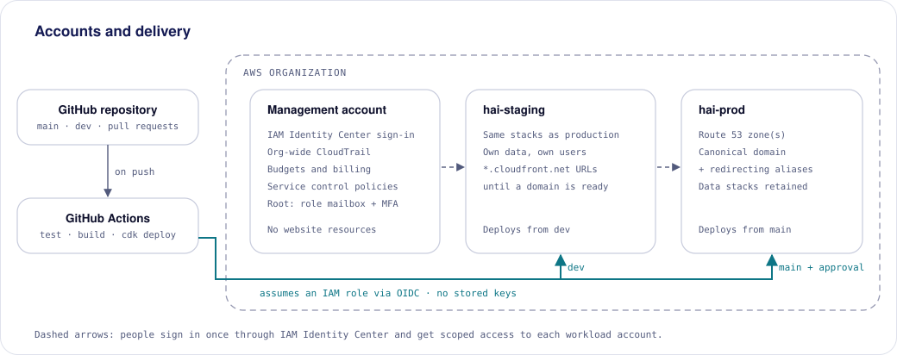

| Account | Purpose | Notes |
|---|---|---|
| Management | Billing, IAM Identity Center, org CloudTrail, Budgets, SCPs | Root email is a university role mailbox. No workloads |
| `hai-staging` | Staging | Deploys from `dev`. Own data and users. `*.cloudfront.net` until a domain exists |
| `hai-prod` | Production | Deploys from `main` with approval. Holds Route 53 zones |

**Regions:** workloads run in `ap-south-1` (Mumbai), the nearest region to Sri Lanka with every required service. CloudFront certificates are in `us-east-1`. Service control policies deny all other regions.

**Day-one checklist for the management account**

- The root user email is a **university role mailbox** (e.g. `humanai-aws@…`), not a personal address. Root MFA on, and root access keys never created.
- People sign in through **IAM Identity Center** with scoped permission sets (`Admin`, `ReadOnly`). No IAM users with long-lived keys. CI uses OIDC roles (§6.6).
- An organization-wide **CloudTrail** trail and **Budgets** alerts.
- **Service control policies:** deny leaving the organization, deny disabling CloudTrail, and restrict regions to `ap-south-1` and `us-east-1` (plus global services).
- The department owns the billing contact and payment method.

### 7.6 Domains

The site must work on **a domain the lab registers** and on **a university subdomain** (e.g. `humanai.cse.mrt.ac.lk`). Either can come first, or both can be live at once. Hostnames are configuration, not code:

```ts
// infra/config/prod.ts (illustrative)
export const prod = {
  canonicalDomain: 'humanai.cse.mrt.ac.lk',   // the one URL we promote; others 301 here
  domains: [
    { name: 'humanai.cse.mrt.ac.lk', dns: 'delegated' },  // university delegates this subdomain to Route 53
    { name: 'humanailab.org', dns: 'route53' },           // lab-registered domain, zone in our account
  ],
}
```

| DNS mode | When | What CDK does | What a person does |
|---|---|---|---|
| `route53` | A domain the lab registers (`.org`/`.com` in Route 53 Registrar; `.lk` via the LK Domain Registry, then point its NS records to Route 53) | Creates the hosted zone and every record: site, `admin.`, SES DKIM/SPF/DMARC, certificate validation | Register the domain once |
| **`delegated`** (preferred for `mrt.ac.lk`) | University IT agrees to delegate the subdomain | Creates a hosted zone and outputs its NS records. Then behaves like `route53` | University IT adds **one NS record set, once** |
| `external` (fallback) | IT will only add individual records | Creates no DNS. The deploy prints the records to hand over | IT adds about 8 records, and again for each new hostname |

In `external` mode the site hostname must be a subdomain (a CNAME can't sit at a zone apex), which `humanai.cse.mrt.ac.lk` already is.

**When more than one domain is live**

- One CloudFront distribution per app lists every hostname as an alias. One ACM certificate covers all of them.
- One domain is **canonical**. A CloudFront Function 301-redirects every other host to it, keeping path and query, and `<link rel="canonical">` agrees. Changing the canonical domain is a one-line config change.
- Cognito callback and sign-out URLs are generated for every admin hostname. Managed login uses Cognito's own domain, so it needs no extra DNS.
- SES sends from the canonical domain (DKIM, SPF, DMARC). Until that is verified, it sends from a verified individual address.
- Releases store media as root-relative paths (`/media/<id>/…`), so content works on every hostname.

**Environment hostnames**

| Environment | Hostnames |
|---|---|
| production | `<canonical>`, `admin.<canonical>`, plus alias domains that redirect |
| staging | `staging.` and `admin.staging.` under a domain we control. Until one is ready, the default `*.cloudfront.net` URLs, so development never waits for DNS |

The domain's hosted zone lives in the **hai-prod** account and delegates a `staging.` sub-zone to the staging account with one NS record.

### 7.7 Capacity and cost

Estimates for `ap-south-1`. Check them against the AWS Pricing Calculator before committing.

| Item | Production | Staging |
|---|---|---|
| Application Load Balancer (internal) | ≈ $20 | ≈ $20 |
| AWS WAF (one web ACL, ~6 rules) | ≈ $11 | ≈ $8 |
| Content API Lambda (SnapStart for Java has no extra charge) | ≈ $1 | < $1 |
| CloudWatch logs and alarms | ≈ $2 | ≈ $1 |
| CloudFront (first 1 TB free), S3 (≈50 GB), DynamoDB, media Lambda, MediaConvert, SES, Route 53 | ≈ $4–7 | ≈ $1–2 |
| **Total** | **≈ $38–41** | **≈ $30–32** |

**Overall ≈ $65–75/month**, plus domain registration (≈$12–15/year). The internal ALB is now the largest fixed cost (≈$40 across both environments). Replacing it with Lambda Function URLs behind CloudFront OAC would save that, at the cost of the ALB's routing flexibility (see ADR-17).

Video egress remains the main variable cost (≈$0.11/GB beyond the free tier). Mitigations: a 720p default, YouTube embeds for long videos, and budget alarms.

### 7.8 Backup and disaster recovery

| Asset | Protection | RPO | RTO |
|---|---|---|---|
| Content database | PITR (35 days) + AWS Backup daily (90-day retention) | ≤ 5 min | < 1 h (restore to new table, repoint via CDK) |
| Published releases | Immutable, versioned bucket | 0 | < 1 min (rollback) |
| Media | Versioned bucket + retained originals | 0 | Minutes (re-process from originals if needed) |
| Users | Cognito (passwords can't be exported) | — | Re-invite users (< 20) |
| Content API | Stateless Lambda. Every deploy is a numbered version | 0 | Seconds (point the `live` alias at an earlier version) |
| Infrastructure | CDK in Git | 0 | < 1 h redeploy |

Regional disaster: accepted risk for now. The public site keeps being served from CloudFront edge caches for cached paths. Cross-region replication of the `content` and `media` buckets is a roadmap option.

### 7.9 Beyond S3 hosting: growing into a dynamic website

**Question:** will hosting the website on S3 become a problem once the site needs to be dynamic?

**Short answer:** S3 on its own would, but this design doesn't depend on S3 alone. **CloudFront is the single entry point**, and it routes by path. Making the site dynamic means adding a compute origin behind a route. It doesn't mean moving off S3, and S3 keeps doing what it's best at (versioned, cheap, immutable files).

**What S3 static hosting can't do**

| Limitation | Effect if left alone | How this architecture handles it |
|---|---|---|
| No server-side rendering | Crawlers and link previews see an empty page. Weak SEO for news and projects | Stage 2: prerender HTML on publish, still on S3. Stage 3: SSR container |
| No per-request logic | No personalised pages, no logged-in areas, no server-side search | `/api/*` already goes to the Java service. Stage 3 adds per-request pages |
| No authentication at the file level | Can't gate pages behind a login | Gated pages are served by compute (SSR or API) with Cognito. Public files stay on S3 |
| Redirects and headers only by rules | Complex redirects need code | CloudFront Functions handle simple cases. Compute handles the rest |
| No server-side forms | Forms need an endpoint | Already solved: `/api/contact` on the Java service |
| Changes need a new release | Content is only as fresh as the last publish | Intended: publishing is the editorial control. Live data (e.g. events) can come from `/api/*` |

**Growth path**

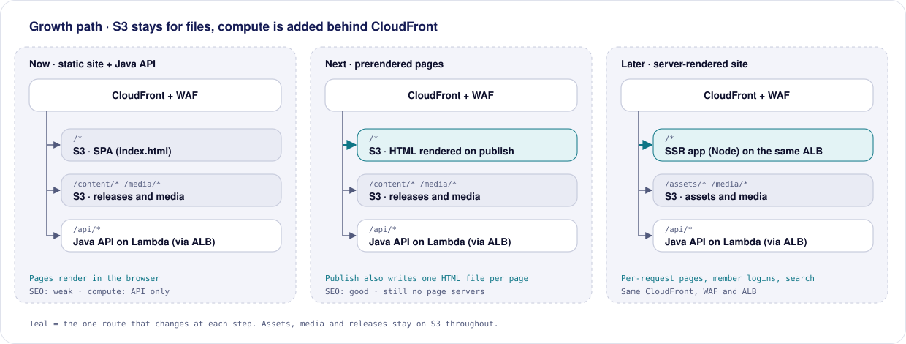

| Stage | Change | Trigger to move | Effort |
|---|---|---|---|
| 1. Now | SPA on S3, releases and media on S3, Java API on Lambda behind the internal ALB | — | This design |
| 2. Prerendered pages | Publish also renders each public route to static HTML on S3 (a render step in the Content API or a small render task) | SEO or link previews matter | Days. No new infrastructure |
| 3. Server-rendered site | Add an SSR service (TanStack Start, Node) as another target of the **same** ALB: a Lambda target, or an ECS Fargate service if long-lived connections are needed. Make it CloudFront's default route. `/assets/*`, `/media/*` and `/content/*` stay on S3 | Pages need per-request data, logged-in areas, or search pages | Weeks. One new target, no re-platforming |
| 4. Richer features | More Java API routes and background workers (Lambda with SQS). Aurora PostgreSQL if relational queries are needed | Events, registrations, member portals | Per feature |

**Guardrails for stage 3:** CloudFront caches SSR pages (`s-maxage` + `stale-if-error`), so a brief compute problem doesn't take pages down. Run at least two SSR tasks across AZs, and keep releases as the source of published content so SSR reads the same data the static site does.

Keeping the internal ALB is what makes stage 3 cheap. It can route by path to Lambda functions and containers side by side, and the VPC origin, WAF, pipeline and monitoring already exist.

---

## 8. Scenarios (+1)

The scenarios validate the other four views: each one exercises logical components, runtime processes, code units and physical nodes together.

### 8.1 Use cases

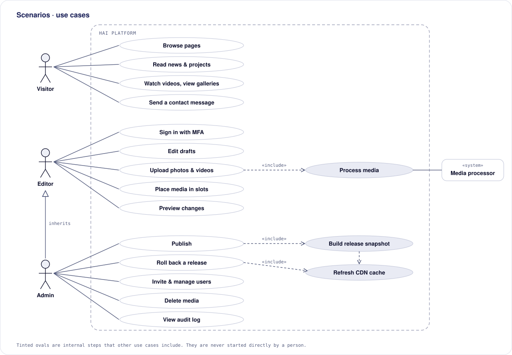

### 8.2 Scenario catalogue

| ID | Scenario | Actor | Logical | Process | Development | Physical |
|---|---|---|---|---|---|---|
| SC-1 | Read a news article | Visitor | Public website, Published content, Media library | CloudFront Function, browser | `apps/web`, `packages/ui` | CloudFront, S3 |
| SC-2 | Upload a video and place it in a slot | Editor | Dashboard, Content API, Upload inbox, Media processor | API Lambda, processor, MediaConvert, EventBridge | `apps/admin`, `services/content-api`, `services/media` | CloudFront, ALB, Lambda, S3, MediaConvert, DynamoDB |
| SC-3 | Publish | Admin | Content API, Published content | API Lambda, publish lock | `services/content-api` (domain: `publish`) | CloudFront + WAF, ALB, Lambda, DynamoDB, S3 |
| SC-4 | Roll back a bad publish | Admin | Content API, Release | API Lambda | `services/content-api` | Lambda, S3, CloudFront |
| SC-5 | Invite a new editor | Admin | Identity, Content API | API Lambda | `services/content-api` (adapter: Cognito) | Lambda, Cognito |
| SC-6 | Send a contact message | Visitor | Contact endpoint | API Lambda | `services/content-api` | CloudFront + WAF, ALB, Lambda, SES |
| SC-7 | An upload fails processing | Editor, Admin | Media processor | Processor retries, DLQ, alarm | `services/media` | Lambda, SQS, CloudWatch |
| SC-8 | Two editors edit the same item | Editors | Content API | Optimistic concurrency | `services/content-api` | DynamoDB |

### 8.3 Scenario walk-throughs

#### SC-1: A visitor reads a news article

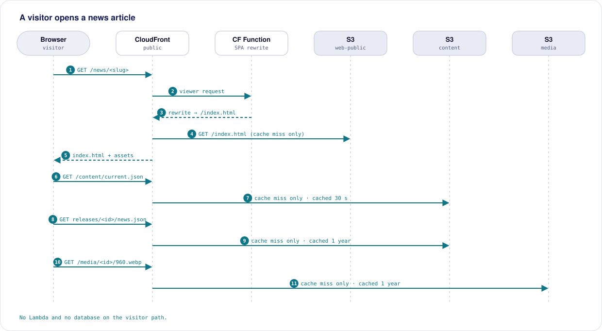

1. The browser requests `/news/<slug>`. A CloudFront Function rewrites it to `/index.html` (edge cache or S3).
2. The app loads `/content/current.json` (30 s cache) to learn the current release id.
3. It loads `/content/releases/<id>/news.json` (immutable, cached for a year).
4. Images load as responsive renditions from `/media/<id>/…`.

**Result:** no API service and no database on the path. It meets the performance and availability targets in §2.3.

#### SC-2: An editor uploads a video and places it

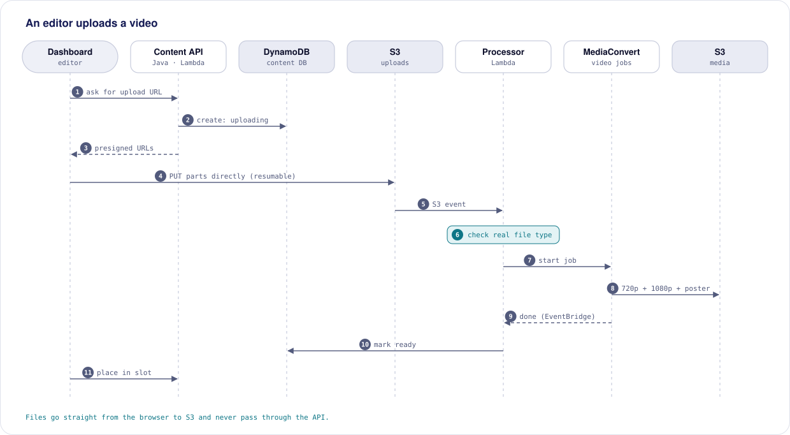

1. The dashboard calls `POST /media/uploads` with the filename, type and size. The API validates them against the limits (video ≤ 2 GB), creates a `MediaAsset` (`uploading`) and returns presigned multipart URLs.
2. The browser uploads the parts **directly to S3**, with resume on failure.
3. The S3 event invokes the processor. It checks the file signature, moves the asset to `processing`, and starts a MediaConvert job (720p and 1080p H.264 MP4, poster, thumbnails).
4. EventBridge reports job completion. The processor records the renditions and marks the asset `ready`.
5. The editor adds alt text and places the video in `home.gallery` (`PUT /slots/home.gallery`).

**Result:** large files never pass through the API service, and the editor sees live status throughout.

#### SC-3: An admin publishes

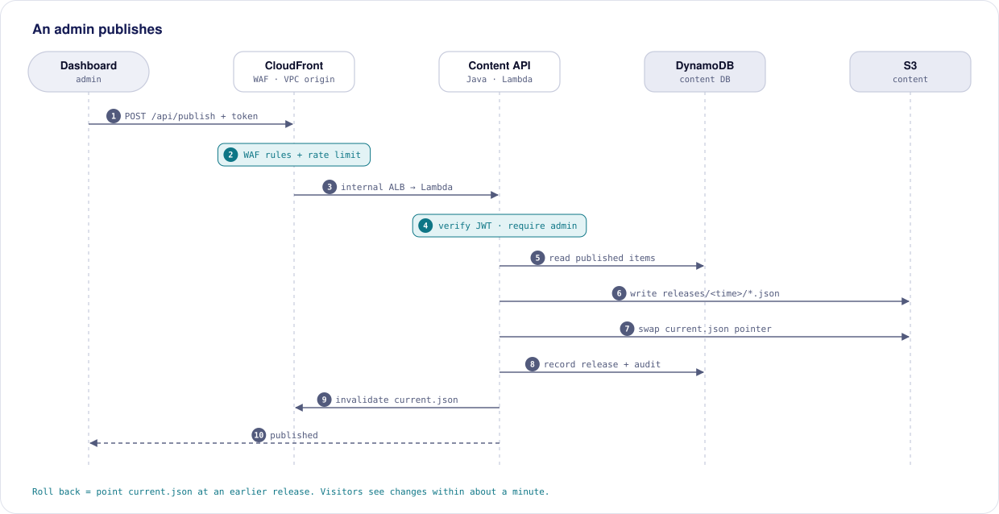

1. The admin selects **Publish** and adds a note. CloudFront applies the WAF rules and forwards the request over the VPC origin to the internal ALB. Spring Security verifies the Cognito token, and the use case requires the `admin` role.
2. The API takes the publish lock, reads every item in `published` state plus slots and placements, and validates them against the schema. Media must be `ready` with alt text.
3. It writes `releases/<id>/*.json` and `sitemap.xml`, then swaps `current.json` in one write.
4. It records the `Release` and an `AuditEvent`, invalidates `/content/current.json` and `/sitemap.xml`, and releases the lock.

**Result:** visitors see the new release within about a minute. A validation failure publishes nothing and lists the problems.

#### SC-4: An admin rolls back

1. On the Releases page, the admin chooses an earlier release and confirms.
2. The API (admin only, under the publish lock) rewrites `current.json` to that release id and records the action.
3. CloudFront invalidates `current.json`. The site shows the earlier release within about a minute.

Drafts are untouched, so the fix can be made and published again.

#### SC-5: An admin invites a new editor

1. The admin enters a name, email and role.
2. The API (using its execution role) calls Cognito `AdminCreateUser` and adds the user to the group. Cognito emails a temporary password.
3. On first sign-in, the user sets a password and enrols an authenticator app (MFA is required).
4. The action is audited. Disabling a user later blocks sign-in immediately, and existing tokens expire within one hour.

#### SC-6: A visitor sends a contact message

1. The form posts to `/api/contact` on the same domain.
2. WAF limits each IP to 10 requests per 5 minutes. The contact endpoint in the Content API checks the honeypot, validates the fields and length, and sends through SES to the lab inbox with `Reply-To` set to the visitor.
3. The form shows success only on a `success: true` response, and shows a retry message on failure. The current frontend wrongly shows success on network failure; this is fixed as part of this work.

#### SC-7: An upload fails processing

1. The processor rejects a file whose content doesn't match an allowed type (e.g. a renamed `.exe`), or MediaConvert reports `ERROR`.
2. The asset becomes `failed` with a reason, and the dashboard shows it with the reason.
3. Invocation errors retry twice, then go to the dead-letter queue, and an alarm emails the maintainers.
4. An admin can **retry** (reprocess from the retained original) or **discard**.

#### SC-8: Two editors edit the same item

1. Both editors load version 7 of a news item.
2. Editor A saves, and the item becomes version 8.
3. Editor B saves with `If-Match: 7`. The API returns `409 VERSION_CONFLICT` with who saved and when.
4. The dashboard offers to reload the latest version while keeping B's text visible for copying. No change is lost silently.

---

## 9. Cross-cutting concerns

### 9.1 Security

| Threat | Mitigation |
|---|---|
| Unauthorised dashboard access | Invite-only Cognito, mandatory TOTP MFA, advanced security features (compromised-credential checks) when budget allows |
| Privilege escalation (editor publishing) | Role checked server-side on every admin-only route. Unit-tested permission matrix (§4.4) |
| Stolen AWS credentials | No long-lived keys. People use Identity Center, CI uses OIDC roles scoped per account and repo branch |
| Malicious uploads (scripts, polyglots) | Type allow-list, magic-byte checks, SVG/HTML rejected, images re-encoded by sharp, videos re-encoded by MediaConvert |
| XSS via content | Markdown rendered without raw HTML. Strict CSP on both sites. Admin on a separate origin |
| Data exposure from storage | Private, encrypted buckets. OAC-only access. Uploads never publicly routable |
| Contact-form spam and abuse | WAF rate limit, honeypot, validation, and Turnstile if needed |
| Bypassing CloudFront to reach the API | Internal ALB with no public address. The ALB security group admits only the CloudFront VPC origin, and the Lambda resource policy admits only the ALB target group. No Function URL |
| API flooding or cost attacks | WAF rate-based rules and managed rule groups. Per-user limits in the app. Lambda reserved concurrency caps total load and cost |
| Vulnerable dependencies | Dependabot for npm and Gradle, managed Lambda runtimes patched by AWS, monthly rebuilds |
| Accidental deletion | Retain policies, PITR, versioning, deletion protection, delete-in-use blocked |
| Loss of access when people leave | Organization + Identity Center. Root on a role mailbox. At least two admins at all times |

### 9.2 Observability

- **Logs:** structured JSON from the Content API and the media Lambda (request id, user sub, route, outcome), 30-day retention. ALB access logs and CloudFront standard logs to S3, 90 days. WAF sampled requests and metrics.
- **Alarms** (SNS → maintainers' email): CloudFront 5xx rate, ALB 5xx, Content API Lambda errors, throttles and p95 duration, WAF blocked-request spikes, media Lambda errors, DLQ depth > 0, MediaConvert failures, budget thresholds.
- **Audit:** every content, media, publish and user action is written to the audit log and viewable by admins.

### 9.3 Privacy

- EXIF/GPS metadata is stripped from all images.
- Contact messages are forwarded by email and not stored. Logs record only metadata, not message bodies.
- CloudFront logs contain IP addresses and are deleted after 90 days.
- Editors are responsible for having consent to publish photos of people. The upload screen reminds them.

### 9.4 Accessibility

- Alt text is required by the schema before media can be placed or published.
- Video: poster frames, and captions (WebVTT upload) are on the roadmap.
- Public components follow `DESIGN.md` §7 (contrast, 44 px touch targets).

### 9.5 SEO

The public site is client-rendered, so crawlers and link previews see little content. Mitigations:
- `sitemap.xml` regenerated on every publish.
- Canonical host redirects.
- Planned prerendering or SSR (§7.9 and §12).

---

## 10. Architecture decisions

| ID | Decision | Alternatives considered | Rationale |
|---|---|---|---|
| ADR-01 | Serverless for all compute (Lambda), with managed services for hosting, data and media | Containers (ECS Fargate), EC2, Lightsail | No servers to patch, near-zero idle compute cost, scales with use (ADR-17) |
| ADR-02 | Build a lightweight custom CMS | Payload/Strapi (self-hosted), Sanity/Contentful (SaaS), Decap/Tina (Git-based) | Data stays in the lab's account, video support, no per-seat fees, same stack. Sanity is the documented fallback |
| ADR-03 | Publish immutable releases to S3, with a single `current.json` pointer | Site reads the API or database at runtime. Rebuild the site on publish | Public availability independent of the backend, atomic switch, instant rollback, no CI in the content path |
| ADR-04 | Separate admin SPA on its own subdomain | `/admin` route in the public app | Stricter CSP, isolated tokens, independent WAF and IP rules, smaller public bundle |
| ADR-05 | Amazon Cognito for identity | Auth0/Clerk, Keycloak, custom auth | Free at our scale, MFA, standard OIDC tokens verified by Spring Security, future university SSO federation |
| ADR-06 | DynamoDB single table | Aurora Serverless / RDS Postgres | No idle cost (Aurora v2 ≈ $40+/month minimum). Access patterns are few and known |
| ADR-07 | MediaConvert → MP4 renditions (HLS later) | Serve originals. HLS from day one | Phone formats (HEVC/MOV) play everywhere after transcoding. MP4 is simpler. Originals kept for re-processing |
| ADR-08 | AWS CDK in TypeScript | Terraform, SAM, console | Same language as the app, reviewable in PRs, strong constructs for CloudFront/OAC |
| ADR-09 | AWS Organization with management, staging and prod accounts | Single account | Blast-radius isolation, continuity, central guardrails, no extra cost |
| ADR-10 | Config-driven domains with a canonical host. Prefer a delegated `mrt.ac.lk` subdomain | Hard-coded hostnames. Individual CNAMEs per record | Supports both domains, one IT ticket, easy canonical switch |
| ADR-11 | Region `ap-south-1` | `ap-southeast-1` (Singapore) | Lowest latency to Sri Lanka with all required services |
| ADR-12 | Keep the SPA now. Add prerendering, then SSR, later | SSR from day one | Ships sooner. Releases already support both. SSR runs as another target of the same ALB (§7.9) |
| ADR-13 | Content API in **Java 21 / Spring Boot 4** | Node.js/TypeScript API | Team preference and skills. Mature security (Spring Security), validation and testing ecosystem. Long-term maintainability for a growing site |
| ADR-14 | ~~Run the API on ECS Fargate behind an internal ALB~~ **Superseded by ADR-17** | — | Kept for history: Fargate removed cold starts but cost ≈ $25–30/month more and needed public-subnet egress (ADR-16) |
| ADR-15 | **Contract-first** API: OpenAPI 3.1 in `contracts/`, generating Java and TypeScript | Hand-written types per language. Zod as the source of truth | Two languages can't share code. A generated contract keeps the dashboard, API and site in step |
| ADR-16 | ~~Fargate tasks in public subnets instead of NAT~~ **Superseded by ADR-17** | — | No longer applies: the Lambda runs outside the VPC and needs no subnets, NAT or public IPs |
| ADR-17 | Run the Java Content API on **AWS Lambda (SnapStart) as the target of an internal ALB**, reached via CloudFront VPC origin + WAF; **no API Gateway** | ECS Fargate (ADR-14). Lambda + API Gateway. Lambda Function URL + CloudFront OAC (no ALB, ≈ $40/month cheaper) | Serverless compute and patching with the same network isolation as before. The ALB keeps path routing for future SSR or containers. Accepted trade-offs: Java cold starts (mitigated by SnapStart), 1 MB body limit, ALB fixed cost |

---

## 11. Risks and technical debt

| Risk | Likelihood | Impact | Mitigation |
|---|---|---|---|
| Fixed cost of the internal ALB and WAF (≈ $60/month of the ≈ $65–75 total) | Certain | Medium | Budget alerts. Staging ALB can be dropped (Function URL + OAC for staging). WAF rules kept minimal |
| CloudFront VPC origin constraints in `ap-south-1` (features, limits) | Low | Medium | Verify in phase 1. Fallback: an internet-facing ALB that only accepts CloudFront's managed prefix list plus a secret origin header |
| Two languages to maintain (Java and TypeScript) | Medium | Medium | Contract-first generation (ADR-15), clear ownership, the same layering rules on both sides |
| Java cold starts on the Content API | Medium | Low | SnapStart with priming, 2048 MB memory, lean dependencies. Provisioned concurrency if needed (paid) |
| SnapStart or arm64 support differs in `ap-south-1`, or `aws-serverless-java-container` handles ALB events differently than expected | Low | Medium | Phase 2 spike before building features. Fallbacks: x86_64, or Spring Cloud Function's ALB adapter |
| ALB → Lambda 1 MB body limit | Low | Low | Paginated lists. Uploads go straight to S3. Large exports (if ever needed) written to S3 and returned as a link |
| Nobody finishes the custom dashboard | Medium | High | Tight v1 scope. Staged delivery (media library first). Sanity fallback (ADR-02) |
| Knowledge loss when students leave | High | High | This document, CDK, Identity Center, role mailbox, at least two admins, onboarding checklist |
| Weak SEO of a client-rendered site | High | Medium | Sitemap now, prerender/SSR next (§12) |
| Video egress cost spike | Low | Medium | 720p default, YouTube embeds, budget alarms |
| University DNS delays | Medium | Low | Staging on `cloudfront.net`. Owned domain as a parallel path |
| SES stays in sandbox | Medium | Low | Request production access early. Verified sender meanwhile |
| Cognito lock-in (password hashes not exportable) | Low | Low | Small user base, so re-invite is acceptable |
| DynamoDB access patterns change | Low | Medium | Access patterns documented (Appendix A). Content volume small enough to migrate by script |

**Known technical debt to clear during migration:**
- Unused imports and variables flagged by `tsc` in the current site.
- The contact form reports success on network failure.
- Hotlinked third-party images.
- The GitHub Pages and Netlify configurations.
- 14 npm audit findings.

---

## 12. Roadmap and migration

| Phase | Deliverable | Exit criterion |
|---|---|---|
| 1. Foundations | AWS Organization + Identity Center. Monorepo restructure. `contracts/`. CDK `Edge`, `Network`, `Data`, `Auth`, `WebPublic`. OIDC. Current static site live on staging | Staging URL serves today's site from AWS |
| 2. Content API and publishing | Spike: Spring Boot on Lambda with SnapStart behind the internal ALB (cold start, ALB events). Then the data model, publish and rollback. Public site reads releases | Site on staging renders entirely from a published release. No public path to the API except through CloudFront |
| 3. Migration | Import `data.json`, Markdown and hotlinked images into the platform. First release | Staging looks identical to today, with no third-party image hosts |
| 4. Dashboard v1 and media | Sign-in, media library, collections, slots, publish, users, audit. Image then video pipeline | Editors can complete SC-2 and SC-3 unaided |
| 5. Contact endpoint | `POST /api/contact` in the Content API + SES, frontend fix | Messages reach the lab inbox |
| 6. Production cut-over | Prod stacks, domains, alarms, budget. Retire GitHub Pages and Netlify | Canonical domain live, GitHub Pages switched off |
| 7. SEO | Prerender on publish (stage 2 of §7.9). SSR as another ALB target if needed (stage 3) | Pages show content with JavaScript disabled |
| Later | University SSO, scheduled publishing, WebVTT captions, HLS, publications search, cross-region backup | As needed |

---

## 13. Open questions

1. Which domain will the lab register, which `mrt.ac.lk` hostname will we request, and which will be canonical?
2. Will university IT delegate the subdomain (preferred), or only add individual records?
3. Which role mailbox owns the AWS root user, and who in the department owns billing?
4. Who are the first two admins? Should sign-in later use university SSO?
5. Typical video length and volume (confirms upload vs. YouTube as the default)?
6. Which inbox receives contact messages?
7. Should staging be public or password-protected?

---

## Appendix A: Data store design

### A.1 DynamoDB single table `hai-content`

| Item | PK | SK | GSI1PK | GSI1SK | Notes |
|---|---|---|---|---|---|
| Content item | `CONTENT#<type>` | `<id>` | — | — | All item fields, `status`, `version` |
| Slug guard | `SLUG#<type>#<slug>` | `SLUG` | — | — | Written in the same transaction as the item |
| Media asset | `MEDIA#<id>` | `META` | `MEDIA` | `<createdAt>` | Status, renditions, alt text |
| Media usage | `MEDIA#<id>` | `USEDBY#<type>#<itemId>` | — | — | Maintained on save, blocks delete |
| Placement | `SLOT#<slotKey>` | `<mediaId>` | — | — | `order`, `visible` |
| Release | `RELEASE` | `<releaseId>` | — | — | `publishedBy`, `note`, `isCurrent` |
| Publish lock | `LOCK` | `PUBLISH` | — | — | TTL attribute, 5 minutes |
| Audit event | `AUDIT#<yyyy-mm>` | `<timestamp>#<userSub>` | — | — | Append-only |

### A.2 Access patterns

| Access pattern | Operation |
|---|---|
| List items of a type | `Query PK = CONTENT#<type>` |
| Get / save an item (with version check) | `GetItem` / `PutItem` + `ConditionExpression` |
| Create an item with a unique slug | `TransactWriteItems` (item + slug guard, `attribute_not_exists`) |
| List media, newest first | `Query GSI1 PK = MEDIA, ScanIndexForward = false` |
| Where is this media used? | `Query PK = MEDIA#<id>, SK begins_with USEDBY#` |
| Placements in a slot | `Query PK = SLOT#<key>` (sorted by `order` in code) |
| Release history | `Query PK = RELEASE, ScanIndexForward = false` |
| Audit for a month | `Query PK = AUDIT#<yyyy-mm>` |
| Build a release | `Query` each content type + slots (small volumes). Filter `status = published` |

### A.3 S3 buckets

| Bucket | Key layout | Versioning | Public route |
|---|---|---|---|
| `web-public` | Vite build output | Off (rebuilt from Git) | `/*` |
| `web-admin` | Vite build output | Off | `admin: /*` |
| `content` | `current.json`, `releases/<id>/*.json`, `sitemap.xml` | On | `/content/*`, `/sitemap.xml` |
| `media` | `<mediaId>/<rendition>` | On | `/media/*` |
| `uploads` | `<mediaId>/original.<ext>` | On | None |

---

## Appendix B: Glossary

| Term | Meaning |
|---|---|
| **Content item** | One editable piece of content (a news article, a member, a publication…) |
| **Draft** | The editable version of an item in the database. Visitors never see drafts |
| **Release** | An immutable snapshot of all published content, stored as JSON files |
| **Publish** | Create a new release and make it current |
| **Rollback** | Make an earlier release current again |
| **Slot** | A named place on the site that shows media (e.g. `home.hero`) |
| **Placement** | Media assigned to a slot, with position and visibility |
| **Rendition** | A processed version of an upload (resized image, web-ready video, poster) |
| **Canonical domain** | The one hostname that is promoted. Others redirect to it |
| **OAC** | Origin Access Control: lets only CloudFront read a private S3 bucket |
| **OIDC role** | An IAM role GitHub Actions assumes with a short-lived token instead of stored keys |
| **PITR** | DynamoDB point-in-time recovery (restore to any second in the last 35 days) |
| **RPO / RTO** | Maximum data loss / maximum time to recover after an incident |

Lab-specific terms (Lab Member, Research Publication, Research Theme…) are defined in [`CONTEXT.md`](../../CONTEXT.md).

---

## Appendix C: Maintaining this document

- The SVG diagrams in [`diagrams/technical-design/`](./diagrams/technical-design/) are generated from [`build.mjs`](./diagrams/technical-design/build.mjs). Edit the data, run `node docs/architecture/diagrams/technical-design/build.mjs`, and commit the SVGs with the document change. File names follow the view they belong to (`logical-*`, `process-*`, `development-*`, `physical-*`, `scenarios-*`).
- The PNG figures in [`diagrams/system-design/`](./diagrams/system-design/) belong to `system-design.md` and are numbered in figure order.
- Record new architectural decisions in §10, with alternatives and rationale, rather than silently editing earlier sections.
- Bump the version in the header and add a change note below.

| Version | Date | Change |
|---|---|---|
| 0.1 | 2026-09-26 | First draft: 4+1 views, API, data design, scenarios, ADRs |
| 0.2 | 2026-09-26 | Content API moved to Java 21 / Spring Boot on ECS Fargate. API Gateway removed; security kept via CloudFront VPC origin, internal ALB, WAF and Spring Security. Contract-first OpenAPI. Added §7.3, §7.4 and §7.9 (growth beyond S3 hosting) |
| 0.3 | 2026-09-26 | Docs reorganised under `docs/architecture/`. Absorbed the unique parts of the retired `aws-architecture.md` and `platform-architecture.md`: dashboard scope (§4.6), media processing rules (§5.6), account day-one checklist (§7.5) and full domain rules (§7.6) |
| 0.4 | 2026-09-26 | Content API moved from ECS Fargate to **Lambda (Java 21, SnapStart) as an internal ALB target** (ADR-17 supersedes ADR-14 and ADR-16). VPC reduced to the ALB only; no NAT, public IPs or VPC endpoints. Cost ≈ $65–75/month |
| 0.5 | 2026-09-26 | Implementation started: Spring Boot 4 (the Lambda adapter for Boot 4 is `aws-serverless-java-container-springboot4`). Repository restructured as planned in §6.1 |
